# データ構造・ER図

[要件定義書](./requirements.md) の詳細ドキュメント。FIT LOG のデータ構造・データベース設計をまとめる。機能 ID（F-xx）は [機能要件](./features.md)、画面 ID（S-xx）は [画面仕様](./screens.md) を参照。

DB は PostgreSQL 17（pg_bigm 入り）、スキーマの管理は Flyway、DB へのアクセスは jOOQ で行う（[技術スタック](./tech-stack.md)）。実装したあとは、この文書のテーブル定義を、実際のマイグレーション（`backend/src/main/resources/db/migration/`）と一致させる。データベースの文字コードは `UTF8`（絵文字もそのまま保存できる）。`VARCHAR(n)` の `n` はバイト数ではなく文字数なので、日本語でも「280文字まで」をそのまま表せる。

## 設計の方針

| 方針 | 内容 | 理由 |
|---|---|---|
| 計算できる値は列に持たない | ナイストレーニング数・コメント数・自己ベスト・推定 1RM・集計値・ペース・消費カロリー・達成率・期限切れかどうかは、表示のたびに SQL で計算する | 投稿の編集・削除で値が食い違うことを防ぐ（[要件定義書 8章](./requirements.md)）。この規模なら計算しても速い（[集計の SQL](#集計の-sql)） |
| 重量・距離は kg・km、時間は秒 | `NUMERIC` で小数第3位まで持つ。単位の換算は表示と入力のときだけ行う | 集計・自己ベスト・目標の判定を1つの単位で行える。`NUMERIC` は 2 進数の誤差が出ないので、lb で入力した値が戻る（[単位の換算](#単位の換算と小数の桁)） |
| 日付と日時を分ける | 実施日・体重の日付・期限は `DATE`（時刻・タイムゾーンなし）。投稿日時などは `TIMESTAMPTZ` | 「11/14 にトレーニングした」は、どのタイムゾーンで見ても 11/14 であるべきため。「今日」は日本時間で計算する（[日付と日本時間](#日付と日本時間)） |
| 種類は `VARCHAR` ＋ `CHECK` | 公開範囲・記録方式などの種類は、PostgreSQL の `ENUM` 型ではなく `VARCHAR` と `CHECK` 制約で表す | 値を足すときに `ALTER TYPE` が要らず、マイグレーションで `CHECK` を張り替えるだけで済む |
| 決まりは DB でも守る | 一意・範囲・「この種類ならこの列が必須」は `UNIQUE` と `CHECK` で DB でも止める | アプリの不具合や同時のリクエストがあっても、おかしなデータが入らないようにする。分かりやすいエラーを返すため、アプリでも同じチェックをする |
| 削除は物理削除 | 論理削除（削除フラグ）はしない。親を消したら子も `ON DELETE CASCADE` で消す | 退会で「すべてのデータを消す」（F-09）を DB で保証する |

## ER図

列は主なものだけを書く（全部の列は[テーブル定義](#テーブル定義)を参照）。

```mermaid
erDiagram
    users ||--o{ refresh_tokens : "ログイン状態を保つ"
    users ||--o| email_verification_tokens : "メールアドレスを確認する"
    users ||--o{ password_reset_tokens : "パスワードを再設定する"
    users ||--o{ exercises : "自分専用の種目を作る"
    users ||--o{ workouts : "記録する"
    users ||--o{ workout_templates : "テンプレートを持つ"
    users ||--o{ likes : "ナイストレーニングする"
    users ||--o{ comments : "コメントする"
    users ||--o{ follows : "フォローする (follower_id)"
    users ||--o{ follows : "フォローされる (followee_id)"
    users ||--o{ notifications : "通知を受け取る (recipient_id)"
    users ||--o{ body_records : "体重を記録する"
    users ||--o{ goals : "目標を持つ"
    users ||--o{ goal_cheers : "応援する"

    workouts ||--|{ workout_exercises : "種目を含む"
    workout_exercises ||--|{ workout_sets : "セットを含む"
    exercises ||--o{ workout_exercises : "記録で使われる"
    workouts ||--o{ workout_images : "画像を持つ"
    workouts ||--o{ workout_hashtags : "ハッシュタグを持つ"
    hashtags ||--o{ workout_hashtags : "投稿に付く"
    workouts ||--o{ likes : "ナイストレーニングされる"
    workouts ||--o{ comments : "コメントされる"
    comments ||--o{ comments : "返信される (parent_id)"

    workout_templates ||--|{ template_exercises : "種目を含む"
    template_exercises ||--|{ template_sets : "セットを含む"
    exercises ||--o{ template_exercises : "テンプレートで使われる"

    exercises ||--o{ goals : "重量・量の目標の対象"
    goals ||--o{ goal_achievements : "くり返しの期間ごとに達成する"
    goals ||--o{ goal_cheers : "応援される"

    users {
        BIGINT id PK
        VARCHAR username UK "@ユーザー名"
        VARCHAR email UK
        TIMESTAMPTZ email_verified_at "未確認ならNULL"
        BOOLEAN is_private "鍵アカウント"
        VARCHAR weight_unit "kg / lb"
        VARCHAR distance_unit "km / mi"
    }

    exercises {
        BIGINT id PK
        BIGINT owner_id FK "最初から用意された種目はNULL"
        VARCHAR name
        VARCHAR body_part "部位"
        VARCHAR record_type "記録方式"
        NUMERIC mets
        BOOLEAN is_running
    }

    workouts {
        BIGINT id PK
        BIGINT user_id FK
        DATE performed_on "実施日"
        VARCHAR body "ひとこと"
        SMALLINT duration_min "トレーニング時間"
        VARCHAR visibility "公開範囲"
        TIMESTAMPTZ created_at "投稿日時"
    }

    workout_exercises {
        BIGINT id PK
        BIGINT workout_id FK
        BIGINT exercise_id FK
        SMALLINT sort_order
    }

    workout_sets {
        BIGINT id PK
        BIGINT workout_exercise_id FK
        SMALLINT sort_order
        NUMERIC weight_kg
        INTEGER reps
        INTEGER duration_sec
        NUMERIC distance_km
    }

    comments {
        BIGINT id PK
        BIGINT workout_id FK
        BIGINT user_id FK
        BIGINT parent_id FK "返信元 返信でなければNULL"
        BIGINT reply_to_user_id FK "返信先のユーザー"
    }

    follows {
        BIGINT id PK
        BIGINT follower_id FK
        BIGINT followee_id FK
        VARCHAR status "pending / accepted"
    }

    goals {
        BIGINT id PK
        BIGINT user_id FK
        VARCHAR goal_type "頻度・量・重量・体重"
        NUMERIC target_value
        DATE achieved_on "重量・体重の達成日"
        VARCHAR visibility
    }

    notifications {
        BIGINT id PK
        BIGINT recipient_id FK
        BIGINT actor_id FK "操作した人"
        VARCHAR type
        TIMESTAMPTZ read_at "未読ならNULL"
    }
```



`template_sets`・`workout_images`・`hashtags`・`likes`・`goal_achievements`・`goal_cheers`・`body_records`・トークンの各テーブルなどは、図では列を省いた。`running_mets`（ランニングの速さごとの METs）・`mail_send_logs`（メールの送信の記録）は、ほかのテーブルと外部キーでつながらないので図に入れていない。

### リレーションのまとめ

| 関係 | 種類 | 説明 |
|---|---|---|
| users – workouts | 1 対 多 | 1人のユーザーはたくさん記録できる |
| workouts – workout_exercises – workout_sets | 1 対 多 対 多 | 投稿 → 種目（1〜20件）→ セット（種目ごとに1〜20件）の親子関係。親を消すと子も消える |
| exercises – workout_exercises | 1 対 多 | 種目は多くの記録で使われる。同じ投稿に同じ種目を2回入れてもよい（F-10） |
| users – exercises | 1 対 多（任意） | 自分専用の種目（100件まで）。最初から用意された種目は `owner_id` が NULL |
| workouts – hashtags（workout_hashtags 経由） | 多 対 多 | 1投稿にハッシュタグは10個まで |
| users – workouts（likes 経由） | 多 対 多 | 同じ組み合わせは1回だけ（一意制約） |
| users – workouts（comments 経由） | 多 対 多 | 何回でもコメントできる |
| comments – comments | 1 対 多（自己参照） | 返信は1段だけ（返信元は、返信でないコメントに限る） |
| users – users（follows 経由） | 多 対 多（自己参照） | 承認待ち（`pending`）と承認済み（`accepted`）の状態を持つ |
| users – workout_templates – template_exercises – template_sets | 1 対 多 対 多 対 多 | テンプレートは記録と同じ形（1人20件まで） |
| users – goals | 1 対 多 | 達成済み以外の目標は10件まで |
| goals – goal_achievements | 1 対 多 | くり返しの目標（頻度・量）の、週・月ごとの達成 |
| users – goals（goal_cheers 経由） | 多 対 多 | 応援は1人1目標につき1回 |
| users – body_records | 1 対 多 | 1日1件まで |
| users – notifications | 1 対 多 | 受け取る人（`recipient_id`）と操作した人（`actor_id`）の2つで users を参照する |

## テーブル定義

共通のルール：

- 主キーはすべて `id BIGINT GENERATED ALWAYS AS IDENTITY`（表では「IDENTITY」と書く）。ただし、多対多をつなぐだけで、ほかから参照されない `workout_hashtags` は、2つの列の組を主キーにする
- 日時の列はすべて `TIMESTAMPTZ`。`created_at` / `updated_at` は、アプリがそのときの時刻（テストで差し替えられる `Clock` から取る）を入れる
- 外部キーの列には、必ずインデックスを作る（PostgreSQL は外部キーの列に自動でインデックスを作らない。作らないと、親を消すときの `ON DELETE CASCADE` が子のテーブルを全部読む）
- 表の「NULL」列：× は `NOT NULL`、○ は NULL を許す

### users（ユーザー）

| カラム | 型 | NULL | 制約・初期値 | 説明 |
|---|---|---|---|---|
| id | BIGINT | × | PK, IDENTITY | |
| username | VARCHAR(15) | × | UNIQUE(LOWER(username))、CHECK(username ~ '^[A-Za-z0-9_]{4,15}$') | `@` の後ろの名前。変更不可。大文字・小文字を区別せずに重複を防ぐ |
| display_name | VARCHAR(50) | × | CHECK(LENGTH(display_name) >= 1) | 表示名 |
| email | VARCHAR(254) | × | UNIQUE、CHECK(email = LOWER(email)) | ログインに使う。小文字にそろえて保存する。変更は確認用のリンクを開いたときに行う（F-06） |
| email_verified_at | TIMESTAMPTZ | ○ | | メールアドレスを確認した日時。NULL なら未確認（画面に案内を出す。F-05） |
| password_hash | VARCHAR(255) | × | | BCrypt でハッシュにしたパスワード |
| bio | VARCHAR(160) | ○ | | 自己紹介 |
| icon_key | VARCHAR(255) | ○ | | アイコン画像の S3 のキー（例：`icons/<uuid>.webp`）。NULL なら表示名の頭文字を出す |
| is_private | BOOLEAN | × | 初期値 `false` | 鍵アカウントかどうか（F-53） |
| weight_unit | VARCHAR(2) | × | 初期値 `'kg'`、CHECK IN ('kg', 'lb') | 重量の単位（F-63） |
| distance_unit | VARCHAR(2) | × | 初期値 `'km'`、CHECK IN ('km', 'mi') | 距離の単位（F-63） |
| created_at | TIMESTAMPTZ | × | | 登録日時 |
| updated_at | TIMESTAMPTZ | × | | 更新日時 |

- メールアドレスの長さは、メールアドレスの規格で使える最大の 254 文字にする
- 退会は行を消す（`DELETE FROM users WHERE id = ?`）。ユーザーに関係する行は、すべて `ON DELETE CASCADE` で消える（[削除で一緒に消えるもの](#削除で一緒に消えるもの)）。行が消えるので、同じメールアドレス・ユーザー名で、すぐに新しく登録できる（ユーザー名をすぐに使えるようにするかは [要件定義書 10章](./requirements.md) の未決定事項。使えないようにする場合は、退会したユーザー名を残すテーブルを足す）

### refresh_tokens（リフレッシュトークン）

前回の SNS アプリと同じ。

| カラム | 型 | NULL | 制約・初期値 | 説明 |
|---|---|---|---|---|
| id | BIGINT | × | PK, IDENTITY | |
| user_id | BIGINT | × | FK → users.id, ON DELETE CASCADE | トークンの持ち主 |
| token_hash | CHAR(64) | × | UNIQUE | トークンの SHA-256 のハッシュ（16進数64文字）。トークンそのものは保存しない |
| expires_at | TIMESTAMPTZ | × | | 有効期限（発行から14日） |
| revoked_at | TIMESTAMPTZ | ○ | | 無効にした日時（再発行・ログアウト・使い回しの検知・パスワードの変更とリセット）。NULL なら有効 |
| rotated_at | TIMESTAMPTZ | ○ | | 再発行で新しいトークンに交換した日時。交換から10秒以内の再利用を「同時のリクエスト」として許す判定に使う |
| created_at | TIMESTAMPTZ | × | | 発行日時 |

- パスワードの変更・リセットのときは、そのユーザーの有効なトークンをすべて無効にする（`revoked_at` を入れる）。パスワードを変更した端末には、新しいトークンを発行し直す（F-07 の「変更した端末だけはログインしたままにする」）
- 期限切れの行は、毎日 4:00（日本時間）に消す（前回と同じ）

### email_verification_tokens（メールアドレスの確認用のトークン）

| カラム | 型 | NULL | 制約・初期値 | 説明 |
|---|---|---|---|---|
| id | BIGINT | × | PK, IDENTITY | |
| user_id | BIGINT | × | FK → users.id, ON DELETE CASCADE、UNIQUE | 1人に1行だけ |
| email | VARCHAR(254) | × | CHECK(email = LOWER(email)) | 確認するメールアドレス。登録のときは今のアドレス、変更のとき（F-06）は新しいアドレス |
| token_hash | CHAR(64) | × | UNIQUE | トークンの SHA-256 のハッシュ |
| expires_at | TIMESTAMPTZ | × | | 有効期限（発行から24時間） |
| created_at | TIMESTAMPTZ | × | | 発行日時 |

- **新しいリンクを送ると前のリンクは使えなくなる**（F-05 の決まり）ことを、`UNIQUE(user_id)` で表す。発行するときは `INSERT … ON CONFLICT (user_id) DO UPDATE` で行を上書きするので、前のトークンのハッシュは消える
- 確認できたら行を消す（1回だけ使える）
  - `email` が `users.email` と同じなら：`users.email_verified_at` に今の時刻を入れる
  - 違うなら（メールアドレスの変更）：`users.email` を新しいアドレスに変え、`email_verified_at` も入れる。リンクを送ってから開くまでの間に、ほかの人が同じアドレスで登録していた場合は、`users.email` の一意制約で止まるので「このメールアドレスはすでに使われています」と返す
- 期限切れの行は、リフレッシュトークンと同じ掃除の処理で消す

### password_reset_tokens（パスワードの再設定用のトークン）

| カラム | 型 | NULL | 制約・初期値 | 説明 |
|---|---|---|---|---|
| id | BIGINT | × | PK, IDENTITY | |
| user_id | BIGINT | × | FK → users.id, ON DELETE CASCADE | |
| token_hash | CHAR(64) | × | UNIQUE | トークンの SHA-256 のハッシュ |
| expires_at | TIMESTAMPTZ | × | | 有効期限（発行から30分） |
| used_at | TIMESTAMPTZ | ○ | | 使った日時。NULL ならまだ使っていない |
| created_at | TIMESTAMPTZ | × | | 発行日時 |

- 再設定に使えるのは `used_at IS NULL AND expires_at > now()` の行だけ。使ったら `used_at` を入れる（1回だけ使える）。2つの端末で同時に使われても1回にするため、`UPDATE … SET used_at = now() WHERE id = ? AND used_at IS NULL` の更新件数が1件のときだけ、パスワードを変える
- 再設定が済んだら、そのユーザーのまだ使っていないほかの再設定用トークンも使えなくする（`used_at` を入れる）
- 期限切れの行は、リフレッシュトークンと同じ掃除の処理で消す

### mail_send_logs（メールの送信の記録）

メールの送信の上限（同じアドレスに1時間で5通まで。[機能要件](./features.md#アカウント管理)）を数えるための表。

| カラム | 型 | NULL | 制約・初期値 | 説明 |
|---|---|---|---|---|
| id | BIGINT | × | PK, IDENTITY | |
| email | VARCHAR(254) | × | | 送った先のアドレス（小文字） |
| mail_type | VARCHAR(20) | × | CHECK IN ('verify_email', 'password_reset') | メールの種類 |
| sent_at | TIMESTAMPTZ | × | | 送った日時 |

- 送る前に `SELECT COUNT(*) FROM mail_send_logs WHERE email = ? AND sent_at > now() - interval '1 hour'` が5未満であることを確かめる
- users を参照しない（外部キーを持たない）。登録されていないアドレスや、変更前の新しいアドレスにも送るため
- 退会しても行は消えないが、1日より古い行は毎日の掃除で消すので、メールアドレスが長く残ることはない

### exercises（種目）

最初から用意された種目と、ユーザーが追加した自分専用の種目を、同じ表に入れる。

| カラム | 型 | NULL | 制約・初期値 | 説明 |
|---|---|---|---|---|
| id | BIGINT | × | PK, IDENTITY | |
| owner_id | BIGINT | ○ | FK → users.id, ON DELETE CASCADE | 自分専用の種目を作った人。最初から用意された種目は NULL |
| name | VARCHAR(30) | × | CHECK(LENGTH(name) >= 1) | 種目の名前（入力したまま） |
| name_key | VARCHAR(30) | × | | 同じ名前かどうかの判定と検索に使う名前。Unicode の NFKC で正規化し（全角英数字を半角にそろえる）、英字を小文字にしたもの。アプリ（Java の `Normalizer`）で作る |
| body_part | VARCHAR(10) | × | CHECK IN ('chest', 'back', 'legs', 'shoulders', 'arms', 'abs', 'full_body', 'cardio') | 部位（胸・背中・脚・肩・腕・腹・全身・有酸素） |
| record_type | VARCHAR(20) | × | CHECK IN ('weight_reps', 'reps', 'time_distance') | 記録方式（重量 × 回数・回数のみ・時間・距離）。あとから変えられない（F-16） |
| mets | NUMERIC(3,1) | × | CHECK(mets > 0) | 消費カロリーの計算に使う METs |
| is_running | BOOLEAN | × | 初期値 `false`、CHECK(NOT is_running OR (owner_id IS NULL AND record_type = 'time_distance')) | ランニングの集計（F-83）の対象か。最初から用意された「時間・距離」の種目だけが true にできる |
| sort_order | SMALLINT | × | 初期値 `0` | 種目の選択の画面で、部位の中に並べる順番（最初から用意された種目だけが使う。自分専用の種目は名前の順） |
| created_at | TIMESTAMPTZ | × | | |
| updated_at | TIMESTAMPTZ | × | | |

- **同じ名前の禁止**（F-14 の決まり：最初から用意された種目と、自分専用の種目の中で同じ名前は不可）
  - 最初から用意された種目どうし：`UNIQUE(name_key) WHERE owner_id IS NULL`（部分一意インデックス）
  - 自分専用の種目どうし：`UNIQUE(owner_id, name_key) WHERE owner_id IS NOT NULL`
  - 自分専用の種目と、最初から用意された種目：DB の制約では表せないので、アプリで確かめる。最初から用意された種目はマイグレーションでしか増えないので、同時のリクエストで重なることはない。あとのマイグレーションで種目を足すときは、同じ名前の自分専用の種目がないかを確かめる
- **自分専用の種目の METs**：作るとき・部位を変えるときに、アプリが次の標準の値を入れる

  | 記録方式 | 部位 | 標準の METs | もとにした活動（改訂版 身体活動のメッツ表） |
  |---|---|---|---|
  | 重量 × 回数 | どれでも | 3.5 | 筋力トレーニング（中程度） |
  | 回数のみ | どれでも | 3.8 | 自体重を使った運動（中程度） |
  | 時間・距離 | 有酸素 | 6.0 | 有酸素運動の全般（中程度） |
  | 時間・距離 | 有酸素以外 | 3.5 | 筋力トレーニング（中程度） |

- **自分専用の種目の削除**（F-16）：記録で使っている種目は削除できない。`workout_exercises.exercise_id` の外部キーを `ON DELETE NO ACTION` にして、DB でも止める。テンプレートで使っている分は `template_exercises` から一緒に消える（`ON DELETE CASCADE`）。目標の対象になっている種目も削除できない（`goals.exercise_id` も `NO ACTION`。「目標で使っている種目は削除できません」と返す）
- 自分専用の種目の数（100件まで）は、アプリで数えて確かめる（[件数の上限](#件数の上限の守り方)）
- 最初から用意された種目の一覧は [種目の初期データ](#種目の初期データ) を参照

### running_mets（ランニングの速さごとの METs）

ランニングの種目で距離のあるセットは、速さ（距離 ÷ 時間）に応じた METs を使う（F-86）。マイグレーションで値を入れる、変わらない表。

| カラム | 型 | NULL | 制約・初期値 | 説明 |
|---|---|---|---|---|
| min_speed_kmh | NUMERIC(4,1) | × | PK | この速さ（km/時）以上なら、この METs を使う |
| mets | NUMERIC(3,1) | × | | |

| 速さ（km/時）以上 | METs | | 速さ（km/時）以上 | METs |
|---|---|---|---|---|
| 0.0 | 6.0 | | 12.9 | 11.8 |
| 8.0 | 8.3 | | 13.8 | 12.3 |
| 8.4 | 9.0 | | 14.5 | 12.8 |
| 9.7 | 9.8 | | 16.1 | 14.5 |
| 10.8 | 10.5 | | 17.7 | 16.0 |
| 11.3 | 11.0 | | 19.3 | 19.0 |
| 12.1 | 11.5 | | 20.9 | 19.8 |
| | | | 22.5 | 23.0 |

- 値は「改訂版 身体活動のメッツ（METs）表」と、そのもとになった Compendium of Physical Activities（2011）のランニングの値（時速 4〜14 マイル）を km/時にしたもの。6.4km/時（ジョギングの下限）より遅いときも 6.0 にする。**実装するときに原典の値と照らし合わせる**
- 使うときは `SELECT mets FROM running_mets WHERE min_speed_kmh <= :speed ORDER BY min_speed_kmh DESC LIMIT 1`
- Java の定数ではなく表にするのは、週・月の消費カロリーの合計を SQL の中で計算するため（[消費カロリー](#消費カロリー)）

### workouts（トレーニング記録・投稿）

| カラム | 型 | NULL | 制約・初期値 | 説明 |
|---|---|---|---|---|
| id | BIGINT | × | PK, IDENTITY | |
| user_id | BIGINT | × | FK → users.id, ON DELETE CASCADE | 投稿者 |
| performed_on | DATE | × | | 実施日。未来の日付は不可（「今日」が日本時間で決まるため、DB の CHECK ではなくアプリで確かめる） |
| body | VARCHAR(280) | × | 初期値 `''` | ひとこと（本文）。空でもよい |
| duration_min | SMALLINT | ○ | CHECK(duration_min BETWEEN 1 AND 1440) | トレーニング時間（分）。NULL なら未入力 |
| visibility | VARCHAR(10) | × | 初期値 `'public'`、CHECK IN ('public', 'followers', 'private') | 公開範囲（公開／フォロワー限定／自分のみ） |
| created_at | TIMESTAMPTZ | × | | 投稿日時（タイムラインの並び順に使う） |
| updated_at | TIMESTAMPTZ | × | | 更新日時 |
| edited_at | TIMESTAMPTZ | ○ | | ユーザーが編集した日時。NULL なら未編集（「編集済み」の表示に使う。前回と同じ） |

- 投稿の検索（F-25）のため、`LOWER(body)` に pg_bigm の索引を作る（[インデックス](#インデックス)）

### workout_exercises（記録の種目）

| カラム | 型 | NULL | 制約・初期値 | 説明 |
|---|---|---|---|---|
| id | BIGINT | × | PK, IDENTITY | |
| workout_id | BIGINT | × | FK → workouts.id, ON DELETE CASCADE | |
| exercise_id | BIGINT | × | FK → exercises.id, ON DELETE NO ACTION | 種目。最初から用意された種目か、投稿者本人の自分専用の種目（アプリで確かめる） |
| sort_order | SMALLINT | × | CHECK(sort_order BETWEEN 1 AND 20) | 並び順 |

- UNIQUE(workout_id, sort_order)
- 同じ投稿に同じ種目を2回入れてもよい（F-10）ので、`(workout_id, exercise_id)` は一意にしない
- `ON DELETE NO ACTION` を `RESTRICT` にしないのは、**退会のとき**のため。退会ではユーザーの行を消すと、自分専用の種目（`exercises`）と、それを使った記録（`workout_exercises`）が同じ1つの `DELETE` 文の中で一緒に消える。`RESTRICT` は行を消すたびにすぐ確かめるので、消す順番によっては失敗する。`NO ACTION` は文の最後に確かめるので、そのときには両方とも消えていて失敗しない

### workout_sets（記録のセット）

| カラム | 型 | NULL | 制約・初期値 | 説明 |
|---|---|---|---|---|
| id | BIGINT | × | PK, IDENTITY | |
| workout_exercise_id | BIGINT | × | FK → workout_exercises.id, ON DELETE CASCADE | |
| sort_order | SMALLINT | × | CHECK(sort_order BETWEEN 1 AND 20) | 並び順 |
| weight_kg | NUMERIC(6,3) | ○ | CHECK(weight_kg BETWEEN 0.226 AND 500) | 重量（kg、小数第3位まで）。重量 × 回数のときだけ |
| reps | INTEGER | ○ | CHECK(reps BETWEEN 0 AND 9999) | 回数。重量 × 回数・回数のみのとき |
| duration_sec | INTEGER | ○ | CHECK(duration_sec BETWEEN 1 AND 86400) | 時間（秒）。時間・距離のときだけ |
| distance_km | NUMERIC(6,3) | ○ | CHECK(distance_km BETWEEN 0.01 AND 500) | 距離（km、小数第3位まで）。時間・距離のときだけ。任意 |

- UNIQUE(workout_exercise_id, sort_order)
- **値の組み合わせ**を CHECK で止める（どの記録方式の形にも当てはまらない行を入れない）

  ```sql
  CHECK (
      (weight_kg IS NOT NULL AND reps IS NOT NULL AND duration_sec IS NULL AND distance_km IS NULL)  -- 重量 × 回数
   OR (weight_kg IS NULL AND reps IS NOT NULL AND duration_sec IS NULL AND distance_km IS NULL)      -- 回数のみ
   OR (weight_kg IS NULL AND reps IS NULL AND duration_sec IS NOT NULL)                              -- 時間・距離（距離は任意）
  )
  ```

- 「種目の記録方式と、セットの形が合っているか」は、別の表（`exercises`）を見ないと分からないので、アプリで確かめる
- 範囲の細かい決まり（重量 × 回数の回数は 0〜999、回数のみは 1〜9999、kg は 0.25 刻み・lb は 0.5 刻み）もアプリで確かめる。DB の CHECK は、どの単位で入力しても入りうる値の範囲にしている（0.5lb ＝ 0.227kg なので、重量の下限は 0.226）
- **編集のとき**は、その投稿の `workout_exercises`（とそれにぶら下がる `workout_sets`）をすべて消して入れ直す。並べ替え・追加・削除を1つずつ差分で直すより単純で、`sort_order` の一意制約にもぶつからない。セットの ID はほかから参照されていないので、変わっても困らない

### workout_images（記録の画像）

前回の SNS アプリの `post_images` と同じ。

| カラム | 型 | NULL | 制約・初期値 | 説明 |
|---|---|---|---|---|
| id | BIGINT | × | PK, IDENTITY | |
| workout_id | BIGINT | × | FK → workouts.id, ON DELETE CASCADE | |
| image_key | VARCHAR(255) | × | | S3 のキー（例：`workouts/2026/11/<uuid>.webp`）。URL ごとは保存しない |
| sort_order | SMALLINT | × | CHECK(sort_order BETWEEN 1 AND 4) | 表示順 |
| created_at | TIMESTAMPTZ | × | | |

- UNIQUE(workout_id, sort_order)
- S3 のバケットは公開しないので、表示するときは、閲覧を許可したあとに署名付き URL を発行する（[技術スタック 3.9](./tech-stack.md)）

### hashtags（ハッシュタグ）

| カラム | 型 | NULL | 制約・初期値 | 説明 |
|---|---|---|---|---|
| id | BIGINT | × | PK, IDENTITY | |
| name | VARCHAR(30) | × | UNIQUE | `#` を除いた名前。NFKC で正規化し、英字を小文字にそろえたもの（F-26 の同一視の決まり） |
| created_at | TIMESTAMPTZ | × | | |

- 登録するときは `INSERT … ON CONFLICT (name) DO NOTHING` のあとに ID を取る（同時に同じハッシュタグが投稿されても重ならない）
- どの投稿からも使われなくなったハッシュタグの行は消さずに残す（行が小さく、次に使われたときにそのまま使える）

### workout_hashtags（投稿とハッシュタグ）

| カラム | 型 | NULL | 制約・初期値 | 説明 |
|---|---|---|---|---|
| workout_id | BIGINT | × | PK, FK → workouts.id, ON DELETE CASCADE | |
| hashtag_id | BIGINT | × | PK, FK → hashtags.id, ON DELETE CASCADE | |

- 主キーは `(workout_id, hashtag_id)`。同じ投稿に同じハッシュタグが何回書かれていても1行にする
- 投稿の作成・編集のときに、ひとことからハッシュタグを取り出して入れ直す（1投稿10個まで。11個目からは保存しない）

### workout_templates・template_exercises・template_sets（テンプレート）

テンプレートは記録と同じ「種目 → セット」の形を持つ（F-17）。

**workout_templates**

| カラム | 型 | NULL | 制約・初期値 | 説明 |
|---|---|---|---|---|
| id | BIGINT | × | PK, IDENTITY | |
| user_id | BIGINT | × | FK → users.id, ON DELETE CASCADE | 持ち主 |
| name | VARCHAR(30) | × | CHECK(LENGTH(name) >= 1) | テンプレートの名前 |
| created_at | TIMESTAMPTZ | × | | |
| updated_at | TIMESTAMPTZ | × | | |

**template_exercises**

| カラム | 型 | NULL | 制約・初期値 | 説明 |
|---|---|---|---|---|
| id | BIGINT | × | PK, IDENTITY | |
| template_id | BIGINT | × | FK → workout_templates.id, ON DELETE CASCADE | |
| exercise_id | BIGINT | × | FK → exercises.id, **ON DELETE CASCADE** | 自分専用の種目を消したら、テンプレートからも外す（F-17 の決まり） |
| sort_order | SMALLINT | × | CHECK(sort_order BETWEEN 1 AND 20) | |

**template_sets**

`workout_sets` と同じ列・制約で、`workout_exercise_id` の代わりに `template_exercise_id`（FK → template_exercises.id, ON DELETE CASCADE）を持つ。

- 自分専用の種目を消してテンプレートの種目が抜けると、`sort_order` に飛びができる（例：1, 3）。並び順として使うだけなので、そのままにする
- 種目が1つもなくなったテンプレートは消さずに残し、一覧で「種目がありません」と表示して、編集で種目を足すまで「使う」を押せなくする

### likes（ナイストレーニング）

前回の SNS アプリと同じ。

| カラム | 型 | NULL | 制約・初期値 | 説明 |
|---|---|---|---|---|
| id | BIGINT | × | PK, IDENTITY | |
| workout_id | BIGINT | × | FK → workouts.id, ON DELETE CASCADE | |
| user_id | BIGINT | × | FK → users.id, ON DELETE CASCADE | 付けた人 |
| created_at | TIMESTAMPTZ | × | | |

- **UNIQUE(workout_id, user_id)**。連打されても `INSERT … ON CONFLICT DO NOTHING` で1件にする
- 取り消しは行を消す

### comments（コメント・返信）

| カラム | 型 | NULL | 制約・初期値 | 説明 |
|---|---|---|---|---|
| id | BIGINT | × | PK, IDENTITY | |
| workout_id | BIGINT | × | FK → workouts.id, ON DELETE CASCADE | |
| user_id | BIGINT | × | FK → users.id, ON DELETE CASCADE | 書いた人 |
| parent_id | BIGINT | ○ | FK → comments.id, ON DELETE CASCADE | 返信元のコメント。返信でなければ NULL |
| reply_to_user_id | BIGINT | ○ | FK → users.id, ON DELETE SET NULL | 返信先のユーザー（`@xxx` の表示と、返信の通知の受け取り手） |
| body | VARCHAR(140) | × | CHECK(LENGTH(body) >= 1) | 本文 |
| created_at | TIMESTAMPTZ | × | | |

- CHECK(parent_id IS NOT NULL OR reply_to_user_id IS NULL)：返信でないコメントには返信先を持たせない（返信なのに返信先が NULL なのは、返信先のユーザーが退会したときだけ）
- **返信は1段だけ**：返信元（`parent_id` の先）が返信でないこと、同じ投稿のコメントであることを、アプリで確かめる。返信への返信は、`parent_id` に同じ返信元を入れ、`reply_to_user_id` に返信したい返信を書いた人を入れる（F-33）
- 返信元を消すと、`ON DELETE CASCADE` で返信も消える（F-32）
- 返信先のユーザーが退会したときは、返信そのものは残し（ほかの人が書いたものなので）、`reply_to_user_id` だけ NULL にする。画面では `@xxx` を出さない
- コメントは編集できないので `updated_at` は持たない

### follows（フォロー・フォローのリクエスト）

| カラム | 型 | NULL | 制約・初期値 | 説明 |
|---|---|---|---|---|
| id | BIGINT | × | PK, IDENTITY | |
| follower_id | BIGINT | × | FK → users.id, ON DELETE CASCADE | フォローする側 |
| followee_id | BIGINT | × | FK → users.id, ON DELETE CASCADE | フォローされる側 |
| status | VARCHAR(10) | × | CHECK IN ('pending', 'accepted') | `pending`：リクエスト中、`accepted`：承認済み |
| created_at | TIMESTAMPTZ | × | | フォロー・リクエストした日時 |
| accepted_at | TIMESTAMPTZ | ○ | CHECK((status = 'accepted') = (accepted_at IS NOT NULL)) | 承認された日時。鍵アカウントでない人へのフォローは、`created_at` と同じ |

- **UNIQUE(follower_id, followee_id)**：リクエスト中も1件と数える（F-50 の決まり）
- **CHECK(follower_id <> followee_id)**：自分自身はフォローできない
- 状態の移り変わり

  | 操作 | 変化 |
  |---|---|
  | 鍵アカウントでない人をフォロー（F-50） | `accepted` の行を作る |
  | 鍵アカウントの人をフォロー（F-50） | `pending` の行を作る |
  | 承認（F-55） | `pending` → `accepted` |
  | 拒否（F-56）・リクエストの取り消し（F-57）・フォロー解除（F-51） | 行を消す |
  | 鍵アカウントをやめる（F-53） | その人への `pending` を、すべて `accepted` にする（1つの `UPDATE`） |

- フォロー数・フォロワー数・閲覧の判定は、`status = 'accepted'` の行だけを使う

### notifications（通知）

| カラム | 型 | NULL | 制約・初期値 | 説明 |
|---|---|---|---|---|
| id | BIGINT | × | PK, IDENTITY | |
| recipient_id | BIGINT | × | FK → users.id, ON DELETE CASCADE | 受け取る人 |
| actor_id | BIGINT | ○ | FK → users.id, ON DELETE CASCADE | 操作した人。目標の達成は NULL |
| type | VARCHAR(20) | × | CHECK IN（下の表） | 通知の種類 |
| workout_id | BIGINT | ○ | FK → workouts.id, ON DELETE CASCADE | 対象の投稿 |
| comment_id | BIGINT | ○ | FK → comments.id, ON DELETE CASCADE | 対象のコメント（コメント・返信のときは、書かれたコメントそのもの） |
| goal_id | BIGINT | ○ | FK → goals.id, ON DELETE CASCADE | 対象の目標 |
| goal_achievement_id | BIGINT | ○ | FK → goal_achievements.id, ON DELETE CASCADE | くり返しの目標の、どの期間の達成か |
| created_at | TIMESTAMPTZ | × | | |
| read_at | TIMESTAMPTZ | ○ | | 既読にした日時。NULL なら未読 |

種類ごとに、値を入れる列：

| type | 内容 | actor_id | workout_id | comment_id | goal_id | goal_achievement_id |
|---|---|---|---|---|---|---|
| `like` | ナイストレーニング | ○ | ○ | | | |
| `comment` | コメント | ○ | ○ | ○ | | |
| `reply` | 返信 | ○ | ○ | ○ | | |
| `follow` | フォローされた | ○ | | | | |
| `follow_request` | フォローのリクエスト | ○ | | | | |
| `follow_accepted` | リクエストが承認された | ○ | | | | |
| `goal_achieved` | 目標の達成 | | | | ○ | くり返しの目標なら ○ |
| `goal_cheer` | 応援 | ○ | | | ○ | |

- 上の表のとおりに値が入っていることを、種類ごとの `CHECK` で止める（例：`CHECK(type <> 'like' OR (actor_id IS NOT NULL AND workout_id IS NOT NULL))`）
- **CHECK(actor_id IS NULL OR actor_id <> recipient_id)**：自分の操作で自分に通知を作らない（F-110 の決まり）
- **対象が消えたら通知も消える**：投稿・コメント・目標を消すと、外部キーの `ON DELETE CASCADE` で通知も消える。操作した人が退会したときも消える
- **取り消したら通知も消す**：ナイストレーニング・応援・フォロー・リクエストを取り消したら、アプリが `DELETE FROM notifications WHERE type = ? AND actor_id = ? AND (workout_id = ? / goal_id = ? / recipient_id = ?)` で消す。リクエストの拒否でも、その `follow_request` の通知を消す
- 承認したときは、リクエストの通知（`follow_request`）を消し、相手に `follow_accepted` を作る
- 同じ人のコメントと返信をまとめる決まり（F-110）は、アプリで作る通知を1件（`reply`）にすることで守る
- 見られなくなった投稿の通知は、一覧と未読数を出す SQL に[閲覧の条件](#閲覧の制御の条件)を足して除く（行は消さない。公開範囲を広げ直したら、また見えるようにするため）
- 保存期間は未決定（[要件定義書 10章](./requirements.md)）。決まったら、古い行を消す処理を毎日の掃除に足す

### body_records（体重の記録）

| カラム | 型 | NULL | 制約・初期値 | 説明 |
|---|---|---|---|---|
| id | BIGINT | × | PK, IDENTITY | |
| user_id | BIGINT | × | FK → users.id, ON DELETE CASCADE | |
| recorded_on | DATE | × | | 日付。未来は不可（アプリで確かめる） |
| weight_kg | NUMERIC(6,3) | × | CHECK(weight_kg BETWEEN 19.95 AND 300) | 体重（kg、小数第3位まで）。44.0lb ＝ 19.958kg なので、下限は lb で入力したときに合わせる |
| body_fat_pct | NUMERIC(3,1) | ○ | CHECK(body_fat_pct BETWEEN 1.0 AND 75.0) | 体脂肪率（%） |
| created_at | TIMESTAMPTZ | × | | |
| updated_at | TIMESTAMPTZ | × | | |

- **UNIQUE(user_id, recorded_on)**：1日1件。同じ日に記録したら上書きする（`INSERT … ON CONFLICT (user_id, recorded_on) DO UPDATE`。F-90）
- 本人以外の API の応答には、どの形でも含めない（[要件定義書 7章](./requirements.md)）

### goals（目標）

| カラム | 型 | NULL | 制約・初期値 | 説明 |
|---|---|---|---|---|
| id | BIGINT | × | PK, IDENTITY | |
| user_id | BIGINT | × | FK → users.id, ON DELETE CASCADE | 目標を持っている人 |
| goal_type | VARCHAR(20) | × | CHECK IN ('frequency', 'volume', 'weight', 'body_weight') | 種類（頻度・量・重量・体重）。あとから変えられない（F-101） |
| name | VARCHAR(30) | × | CHECK(LENGTH(name) >= 1) | 名前（自動で作り、ユーザーが変えられる） |
| period | VARCHAR(5) | ○ | CHECK IN ('week', 'month') | くり返しの期間（頻度・量のとき） |
| metric | VARCHAR(10) | ○ | CHECK IN ('volume', 'duration', 'distance') | 何の合計か（量のとき）：総挙上量（kg）・運動時間（分）・距離（km） |
| target_value | NUMERIC(10,3) | × | CHECK(target_value > 0) | 目標値（日数・kg・分・km） |
| exercise_id | BIGINT | ○ | FK → exercises.id, ON DELETE NO ACTION | 対象の種目（重量のときは必須、量のときは任意） |
| body_part | VARCHAR(10) | ○ | CHECK IN（exercises.body_part と同じ） | 対象の部位（量のときに任意） |
| started_on | DATE | × | | 目標を作った日（日本時間）。くり返しの目標の「これまで何期間のうち何回達成したか」と、体重の目標の開始時の体重を決めるのに使う |
| deadline | DATE | ○ | | 期限（重量・体重のときに任意）。今日より後の日付（アプリで確かめる） |
| achieved_on | DATE | ○ | | 達成した日（重量・体重のとき）。NULL なら未達成 |
| visibility | VARCHAR(10) | × | 初期値 `'private'`、CHECK IN ('public', 'followers', 'private') | 公開範囲 |
| created_at | TIMESTAMPTZ | × | | |
| updated_at | TIMESTAMPTZ | × | | |

種類ごとの決まりを CHECK で止める：

| goal_type | period | metric | exercise_id | body_part | deadline・achieved_on | target_value | visibility |
|---|---|---|---|---|---|---|---|
| frequency | 必須 | NULL | NULL | NULL | NULL | 整数（`target_value = TRUNC(target_value)`）。week は 1〜7、month は 1〜31 | どれでも |
| volume | 必須 | 必須 | 任意 | 任意（exercise_id と同時には入れない） | NULL | > 0 | どれでも |
| weight | NULL | NULL | 必須 | NULL | 任意 | > 0 | どれでも |
| body_weight | NULL | NULL | NULL | NULL | 任意 | 19.95〜300 | **`private` だけ**（体重の目標は公開できない） |

- **開始時の体重**は列に持たず、`started_on` 以前で一番近い日の `body_records` から毎回求める。体重の記録を消したときに「次に近い記録を開始時の体重にする」（S-25）を、そのまま満たせる。`started_on` 以前の記録がすべて消えた場合は、`started_on` より後で一番近い記録を使う
- **期限切れ**は列に持たず、`deadline < 今日 AND achieved_on IS NULL` で判定する
- **達成済み以外の目標の数**（10件まで）は、`achieved_on IS NULL` の行を数える（くり返しの目標は、達成済みにならないので、ずっと数に入る）
- 重量・量の目標の種目は、最初から用意された種目か本人の自分専用の種目であること、重量の目標なら「重量 × 回数」の種目であることを、アプリで確かめる
- `exercise_id` を `NO ACTION` にする理由は、`workout_exercises` と同じ（退会のとき、目標と自分専用の種目が同じ `DELETE` 文の中で消えるため）
- 重量・体重の目標は、達成したあとに記録が変わって 100% を下回っても、`achieved_on` を消さない（F-104 の決まり）

### goal_achievements（くり返しの目標の達成）

頻度・量の目標の、週・月ごとの達成を記録する（F-104・F-105）。

| カラム | 型 | NULL | 制約・初期値 | 説明 |
|---|---|---|---|---|
| id | BIGINT | × | PK, IDENTITY | |
| goal_id | BIGINT | × | FK → goals.id, ON DELETE CASCADE | |
| period_start | DATE | × | | 達成した期間の初日（週なら月曜日、月なら1日） |
| achieved_on | DATE | × | | 達成した日（その期間の記録の保存で 100% になった日。日本時間） |
| created_at | TIMESTAMPTZ | × | | |

- **UNIQUE(goal_id, period_start)**：1つの期間に1回だけ記録する。判定は `INSERT … ON CONFLICT DO NOTHING` で入れ、**行を作れたときだけ**通知を作る。これで「通知は期間ごとに1回だけ」（F-104 の決まり）を、同時に2件の記録が保存されたときも守れる
- 重量・体重の目標の達成も同じ考え方で、`UPDATE goals SET achieved_on = ? WHERE id = ? AND achieved_on IS NULL` の更新件数が1件のときだけ通知を作る
- 記録を消して、その期間が 100% を下回っても、行は消さない（重量・体重の目標と同じく、達成は取り消さない）

### goal_cheers（目標への応援）

| カラム | 型 | NULL | 制約・初期値 | 説明 |
|---|---|---|---|---|
| id | BIGINT | × | PK, IDENTITY | |
| goal_id | BIGINT | × | FK → goals.id, ON DELETE CASCADE | |
| user_id | BIGINT | × | FK → users.id, ON DELETE CASCADE | 応援した人 |
| created_at | TIMESTAMPTZ | × | | |

- **UNIQUE(goal_id, user_id)**：1人1目標につき1回
- 本人は自分の目標を応援できない（goals を見ないと分からないので、アプリで確かめる）
- 目標の公開範囲を狭めても行は消さない（F-107 の決まり）

## 閲覧の制御の条件

[機能要件の閲覧の制御](./features.md#閲覧の制御)を、1つの SQL の条件にまとめる。ログインしているユーザーの ID を `:me`、投稿を `w`、投稿者を `u` とする。

```sql
-- 「:me が投稿 w を見てよいか」
w.user_id = :me                                        -- 本人はすべて見られる
OR (
    w.visibility <> 'private'                          -- 自分のみの投稿は、本人以外は見られない
    AND (
        (w.visibility = 'public' AND NOT u.is_private) -- 鍵アカウントでない人の公開の投稿は、全員が見られる
        OR EXISTS (                                    -- それ以外（フォロワー限定・鍵アカウントの公開）は、承認済みのフォロワーだけ
            SELECT 1 FROM follows f
            WHERE f.follower_id = :me
              AND f.followee_id = w.user_id
              AND f.status = 'accepted'
        )
    )
)
```

- jOOQ では、この条件を `WorkoutVisibility.visibleTo(me)` のような1つの `Condition` を返すメソッドにまとめ、タイムライン・プロフィール・検索・詳細・ナイストレーニング・コメント・通知・画像の URL の発行のすべてで使う（[技術スタック 3.3](./tech-stack.md)）。書き漏れがないことは、入口ごとのテストで確かめる
- 公開した目標（`goals.visibility`）も、同じ形の条件で判定する。ただし体重の目標は `visibility = 'private'` なので、本人以外には出ない
- 鍵アカウントでない人へのフォローはすぐに `accepted` になるので、「フォロワー」はすべて「承認済みのフォロワー」として1つの条件で書ける
- 鍵アカウントのプロフィールで、フォロー・フォロワー一覧を見てよいか（F-52 の決まり）は、`u.id = :me OR NOT u.is_private OR EXISTS(承認済みのフォロー)` で判定する

## 集計の SQL

集計値は列に持たず、表示のたびに SQL で計算する（[要件定義書 5.5](./requirements.md)）。代表的なものの書き方を示す。jOOQ では同じ形を型つきで書く。

### 自己ベストと「自己ベスト更新」の印

自己ベスト（F-85）は、その種目の「重量 × 回数」のセットのうち、回数が1回以上のセットの最大重量。印は「その記録のその種目の最大重量が、それより**前**のすべての記録の最大重量を超えたとき」に付ける。「前」は、`(実施日, 投稿日時, ID)` の順で前の記録。

```sql
-- 表示する投稿（:workout_ids）について、種目ごとに「前の記録までの自己ベスト」を求め、超えていれば印を付ける
WITH this_max AS (                                  -- 表示する投稿の、種目ごとの最大重量
    SELECT w.id AS workout_id, w.user_id, w.performed_on, w.created_at,
           we.exercise_id, MAX(s.weight_kg) AS max_weight
    FROM workouts w
    JOIN workout_exercises we ON we.workout_id = w.id
    JOIN workout_sets s       ON s.workout_exercise_id = we.id
    WHERE w.id = ANY(:workout_ids) AND s.weight_kg IS NOT NULL AND s.reps >= 1
    GROUP BY w.id, w.user_id, w.performed_on, w.created_at, we.exercise_id
)
SELECT t.workout_id, t.exercise_id, t.max_weight,
       prev.best AS previous_best,
       (prev.best IS NOT NULL AND t.max_weight > prev.best) AS is_personal_best
FROM this_max t
CROSS JOIN LATERAL (                                -- 同じ人・同じ種目の、それより前の記録の最大重量
    SELECT MAX(s2.weight_kg) AS best
    FROM workouts w2
    JOIN workout_exercises we2 ON we2.workout_id = w2.id
    JOIN workout_sets s2       ON s2.workout_exercise_id = we2.id
    WHERE w2.user_id = t.user_id
      AND we2.exercise_id = t.exercise_id
      AND s2.weight_kg IS NOT NULL AND s2.reps >= 1
      AND (w2.performed_on, w2.created_at, w2.id) < (t.performed_on, t.created_at, t.workout_id)
) prev;
```

- 公開範囲に関係なく、その人のすべての記録と比べる（F-85 の決まり。印から非公開の記録の値は分からない）
- `prev.best IS NULL`（その種目を初めて記録した）なら印を付けない
- 同じ投稿に同じ種目が2回あるときは、2つをまとめた最大重量で判定し（上の `GROUP BY` がまとめる）、最大重量を出した方（並び順が前の方）の種目とセットに印を付ける。どのセットかは、取ってきたセットの中から Java で選ぶ
- 1ページ（20件）の投稿について1回の SQL で求める。1人あたり1年で約300件の記録なので、`LATERAL` の中は「その人の、その種目の記録」をインデックスでたどるだけで済む

### 週間・月間の集計

```sql
-- :from 〜 :to（週なら月曜〜日曜、月なら1日〜末日）の、本人の記録の集計
SELECT
    COUNT(DISTINCT w.performed_on)                                       AS training_days,
    COALESCE(SUM(s.weight_kg * s.reps), 0)                               AS total_volume_kg,
    COALESCE(SUM(s.duration_sec), 0)                                     AS total_duration_sec,
    COALESCE(SUM(s.distance_km), 0)                                      AS total_distance_km
FROM workouts w
JOIN workout_exercises we ON we.workout_id = w.id
JOIN workout_sets s       ON s.workout_exercise_id = we.id
WHERE w.user_id = :me
  AND w.performed_on BETWEEN :from AND :to;
```

- 部位別のセット数は、`exercises` を JOIN して `GROUP BY e.body_part` で数える
- 曜日ごと・週ごとのグラフは、`generate_series(:from, :to, interval '1 day')` で日付の並びを作って `LEFT JOIN` し、記録のない日も 0 で返す
- 月間の週ごとの推移は `date_trunc('week', w.performed_on)` で月曜始まりの週にまとめる（月をまたぐ週は、`WHERE` でその月の日だけに絞ってからまとめるので、その月の日だけを数える）
- 前の期間との差は、同じ SQL を前の期間で実行して Java で引き算する

### ランニングの集計

```sql
SELECT
    COALESCE(SUM(s.distance_km), 0)                                       AS total_distance_km,
    COALESCE(SUM(s.duration_sec), 0)                                      AS total_duration_sec,
    COUNT(*)                                                              AS run_count,
    -- 平均ペース（秒/km）：距離のあるセットの時間の合計 ÷ 距離の合計（1回ごとのペースの平均ではない）
    SUM(s.duration_sec) FILTER (WHERE s.distance_km IS NOT NULL)
        / NULLIF(SUM(s.distance_km), 0)                                   AS avg_pace_sec_per_km
FROM workouts w
JOIN workout_exercises we ON we.workout_id = w.id
JOIN exercises e          ON e.id = we.exercise_id AND e.is_running
JOIN workout_sets s       ON s.workout_exercise_id = we.id
WHERE w.user_id = :me
  AND w.performed_on BETWEEN :from AND :to;
```

- 最速ペースは、`s.distance_km >= 1` のセットを `ORDER BY s.duration_sec / s.distance_km, s.distance_km DESC, w.performed_on DESC LIMIT 1` で1件取る（F-83 の同じ値のときの決まりの順）。最長距離は `ORDER BY s.distance_km DESC, s.duration_sec, w.performed_on DESC LIMIT 1`
- 年間の月ごとの走行距離は `date_trunc('month', w.performed_on)` でまとめる

### 種目ごとの推移

```sql
-- 重量 × 回数の種目：実施日ごとの最大重量と、最大の推定 1RM（Epley 式。1〜10回のセットだけ。1回のセットは重量そのもの）
SELECT w.performed_on,
       MAX(s.weight_kg) FILTER (WHERE s.reps >= 1)                       AS max_weight_kg,
       MAX(CASE WHEN s.reps = 1 THEN s.weight_kg
                ELSE s.weight_kg * (1 + s.reps / 30.0) END)
           FILTER (WHERE s.reps BETWEEN 1 AND 10)                         AS max_e1rm_kg
FROM workouts w
JOIN workout_exercises we ON we.workout_id = w.id AND we.exercise_id = :exercise_id
JOIN workout_sets s       ON s.workout_exercise_id = we.id
WHERE w.user_id = :me
  AND w.performed_on >= :from          -- 全期間なら付けない
GROUP BY w.performed_on
ORDER BY w.performed_on;
```

- 回数が1回のセットを Epley 式に入れると `重量 × 1.033…` になるが、F-84 の決まり（1回のセットは重量そのもの）に合わせて `CASE` で重量をそのまま使う
- 回数のみ・時間・距離の種目は、同じ形で `SUM(s.reps)`・`MAX(s.reps)`、`SUM(s.duration_sec)`・`SUM(s.distance_km)` を実施日ごとに出す

### 消費カロリー

> 消費カロリー（kcal）＝ METs × 体重（kg）× 時間（時間）× 1.05（F-86）

記録1件ごとに、次の順で計算する。週間・月間は、期間の記録ごとの値を合計する（計算できなかった記録は除き、除いたことを応答に入れる）。

1. **体重**：`SELECT weight_kg FROM body_records WHERE user_id = :me AND recorded_on <= w.performed_on ORDER BY recorded_on DESC LIMIT 1`（`LATERAL` で記録ごとに取る）。なければ計算しない
2. **有酸素の部分**：「時間・距離」のセットごとに、`METs × 体重 × duration_sec / 3600 × 1.05`。METs は、ランニングの種目で距離があれば `running_mets` から速さ（`distance_km / (duration_sec / 3600.0)`）で引き、それ以外は種目の `mets`
3. **筋トレの部分**：トレーニング時間（`duration_min`）があるときだけ。METs は筋トレの種目の METs をセット数で重みづけた平均（`SUM(e.mets) / COUNT(*)`。セット1行ごとに種目の METs を足すので、そのままセット数での重みづけになる）。時間は `duration_min / 60 − 有酸素の時間の合計`（0 以下なら 0）
4. 合計を整数に四捨五入する

- 本人の記録の詳細と、本人の集計の API だけで計算し、ほかの応答には含めない

## 単位の換算と小数の桁

- 重量・距離は `NUMERIC(6,3)`（整数部3桁・小数第3位まで）で、kg・km にして保存する。Java では `BigDecimal` で受け取り、`double` にしない（2 進数の誤差で、表示し直したときに入力した値に戻らなくなるのを防ぐ）
- 換算：1lb ＝ 0.45359237kg、1マイル ＝ 1.609344km。kg・km にするときは小数第4位で四捨五入する（`RoundingMode.HALF_UP`）
- 入力した値に戻ることの確認（[要件定義書 7章](./requirements.md)）：lb の入力は 0.5 刻みなので、保存した kg（誤差は最大 0.0005kg ＝ 約 0.0011lb）を lb に戻して 0.5 単位に丸めれば、必ず入力した値に戻る。距離も同じ（0.01 マイル刻みに対して、誤差は最大 0.0005km ＝ 約 0.0003 マイル）

  | 入力 | 保存（kg） | 表示し直し |
  |---|---|---|
  | 135lb | 61.235 | 61.235 ÷ 0.45359237 ＝ 135.0001… → 0.5 単位に丸めて 135lb |
  | 0.5lb | 0.227 | 0.5004… → 0.5lb |
  | 1100lb | 498.952 | 1100.0006… → 1100lb |

- 集計の合計（総挙上量など）は `NUMERIC` のまま計算し、表示するときに換算・丸める

## 日付と日本時間

- 「今日」「今週」「今月」は、アプリが日本時間（`Asia/Tokyo`）で決める。DB のセッションのタイムゾーンには頼らない（RDS とローカルで設定が違っても、結果が変わらないように）
- 実施日（`performed_on`）は `DATE` なので、週・月の区切りはそのまま日付で計算できる（`date_trunc('week', …)` は月曜始まり）
- `started_on`・`achieved_on`・`period_start` も、アプリが日本時間で計算した日付を入れる

## インデックス

一意制約・主キーには自動でインデックスが作られる。外部キーの列には作られないので、すべて明示的に作る。

| テーブル | インデックス | 使う場面 |
|---|---|---|
| users | UNIQUE(LOWER(username)) | ユーザー名の重複の確認、プロフィールの表示 |
| users | UNIQUE(email) | ログイン、重複の確認、パスワードのリセット |
| users | (created_at DESC, id DESC) | 新しいユーザー一覧（F-71） |
| users | GIN(LOWER(username) gin_bigm_ops)<br>GIN(LOWER(display_name) gin_bigm_ops) | ユーザー検索の部分一致（F-70） |
| refresh_tokens | UNIQUE(token_hash)、(user_id) | 前回と同じ |
| email_verification_tokens | UNIQUE(user_id)、UNIQUE(token_hash) | 確認・再送 |
| password_reset_tokens | UNIQUE(token_hash)、(user_id) | 再設定、ほかのトークンを使えなくする |
| mail_send_logs | (email, sent_at) | 送信の上限の確認 |
| exercises | UNIQUE(name_key) WHERE owner_id IS NULL<br>UNIQUE(owner_id, name_key) WHERE owner_id IS NOT NULL | 同じ名前の禁止。2つ目は、自分専用の種目の一覧と検索、退会のときの CASCADE にも使う |
| workouts | (user_id, created_at DESC, id DESC) | フォロー中タイムライン（自分とフォロー相手の投稿を新しい順） |
| workouts | (created_at DESC, id DESC) | 全体タイムライン、新しい投稿の件数（F-24） |
| workouts | (user_id, performed_on DESC, created_at DESC, id DESC) | プロフィールの投稿一覧（実施日の新しい順。F-62）、集計・カレンダー・推移（期間で絞る）、自己ベストの「前の記録」、体重の目標などの判定 |
| workouts | GIN(LOWER(body) gin_bigm_ops) | ひとことの部分一致検索（F-25） |
| workout_exercises | UNIQUE(workout_id, sort_order) | 投稿の種目を並び順に取る |
| workout_exercises | (exercise_id, workout_id) | 種目での絞り込み（F-27）、種目ごとの推移・自己ベスト、自分専用の種目を消せるかの確認 |
| workout_sets | UNIQUE(workout_exercise_id, sort_order) | 種目のセットを並び順に取る |
| workout_images | UNIQUE(workout_id, sort_order) | 投稿の画像 |
| workout_hashtags | PK(workout_id, hashtag_id)、(hashtag_id, workout_id) | 投稿のハッシュタグ、ハッシュタグでの検索（F-26） |
| hashtags | UNIQUE(name) | ハッシュタグを名前で探す |
| workout_templates | (user_id) | テンプレート一覧 |
| template_exercises | UNIQUE(template_id, sort_order)、(exercise_id) | テンプレートの種目、自分専用の種目を消すときの CASCADE |
| template_sets | UNIQUE(template_exercise_id, sort_order) | |
| likes | UNIQUE(workout_id, user_id)、(user_id) | 数と、付けたかどうか（前回と同じ） |
| comments | (workout_id, created_at, id) WHERE parent_id IS NULL | 返信元のコメントを古い順に（F-31） |
| comments | (parent_id, created_at, id) | 返信を古い順に、返信元を消すときの CASCADE |
| comments | (workout_id) | コメント数（返信を含む）、投稿を消すときの CASCADE |
| comments | (user_id)、(reply_to_user_id) | 退会のときの CASCADE・SET NULL |
| follows | UNIQUE(follower_id, followee_id) | フォロー中の人、閲覧の判定（`EXISTS`） |
| follows | (followee_id, status, created_at DESC) | フォロワー一覧・フォロワー数、リクエスト一覧（F-54）、鍵アカウントをやめたときの一括承認 |
| notifications | (recipient_id, created_at DESC, id DESC) | 通知一覧（F-111） |
| notifications | (recipient_id) WHERE read_at IS NULL | 未読数（F-112）。未読の行だけを持つので小さい |
| notifications | (actor_id)、(workout_id)、(comment_id)、(goal_id)、(goal_achievement_id) | 取り消し・対象を消したときの削除と CASCADE |
| body_records | UNIQUE(user_id, recorded_on) | 体重の一覧・推移、実施日以前で一番近い体重（消費カロリー・目標） |
| goals | (user_id)、(exercise_id) | 目標一覧、種目を消せるかの確認 |
| goal_achievements | UNIQUE(goal_id, period_start) | 達成の履歴、期間ごとに1回の判定 |
| goal_cheers | UNIQUE(goal_id, user_id)、(user_id) | 応援の数と、応援したかどうか |

### 日本語の部分一致検索（pg_bigm）

- 前回はユーザー検索に pg_trgm（3文字ずつ）を使ったが、2文字の語（「胸筋」など）で索引が効かない。今回は投稿の検索もあるので、**pg_bigm**（2文字ずつ）を使う（[技術スタック 3.2](./tech-stack.md)）
- 大文字・小文字を区別しないため、`LOWER(列)` に索引を作り、検索も `LOWER(body) LIKE '%' || LOWER(:q) || '%'` で行う（`ILIKE` は pg_bigm の索引を使えないため）
- キーワードの `%` `_` `\` は `\` でエスケープしてから使う（前回と同じ）
- pg_bigm は1文字のキーワードでも索引を使えるが、当てはまる行が多く遅くなりやすい。性能はパフォーマンステストで確かめる

```sql
CREATE EXTENSION IF NOT EXISTS pg_bigm;
CREATE INDEX idx_workouts_body_bigm       ON workouts USING gin (LOWER(body) gin_bigm_ops);
CREATE INDEX idx_users_username_bigm      ON users    USING gin (LOWER(username) gin_bigm_ops);
CREATE INDEX idx_users_display_name_bigm  ON users    USING gin (LOWER(display_name) gin_bigm_ops);
```

## N+1 問題を防ぐ

前回の SNS アプリと同じく、一覧で1件ごとに SQL を投げない。今回は jOOQ の `multiset` を使い、投稿 → 種目 → セット・画像を1回の SQL でまとめて取る（[技術スタック 3.3](./tech-stack.md)）。

| 取りたいもの | 取り方 |
|---|---|
| 1件に対して1件（投稿 → 投稿者、セット → 種目） | `JOIN` |
| 件数・有無（ナイストレーニング数、付けたかどうか、コメント数、応援の数） | 同じ SQL の中のサブクエリ（`COUNT(*)`・`EXISTS`） |
| 1件に対して複数件（投稿 → 種目 → セット、投稿 → 画像） | `multiset`（PostgreSQL が入れ子を JSON にまとめて返す。`LIMIT 20` が「20件の投稿」のまま保てる） |
| 自己ベストの印 | ページの投稿の ID を `ANY(:workout_ids)` で渡し、1回の SQL で求める（[自己ベスト](#自己ベストと自己ベスト更新の印)） |

- 一覧の API を足したら、「件数が少ないときと多いときで、DB に送る SQL の数が同じ」ことを確かめるテストを書く（前回と同じ）

## 件数の上限の守り方

「1人20件まで」のような上限は、行を数えてから足す。同時に2つのリクエストが来ると、どちらも「まだ19件」と数えて21件になりうるので、**数える前にそのユーザーの行をロックする**（`SELECT … FROM users WHERE id = :me FOR UPDATE`）。

| 上限 | 数えるもの |
|---|---|
| 自分専用の種目 100件 | `exercises WHERE owner_id = :me` |
| テンプレート 20件 | `workout_templates WHERE user_id = :me` |
| 達成済み以外の目標 10件 | `goals WHERE user_id = :me AND achieved_on IS NULL` |
| 投稿の種目 20件・セット 20件・画像 4枚・ハッシュタグ 10個 | 1回のリクエストの中の数なので、ロックは要らない（種目・セット・画像の並び順の CHECK でも止まる） |

## 削除で一緒に消えるもの

すべての外部キーに `ON DELETE` を指定する。

| 削除するもの | 一緒に消えるもの |
|---|---|
| 投稿（F-12） | 種目・セット・画像の行・ハッシュタグとの関連・ナイストレーニング・コメント（と返信）・その投稿とコメントについての通知 |
| コメント（F-32） | その返信、そのコメントについての通知 |
| 自分専用の種目（F-16） | テンプレートの中のその種目とセット。記録・目標で使っていれば削除できない（`NO ACTION`） |
| テンプレート | その種目とセット |
| 目標（F-102） | 達成の記録・応援・その目標についての通知 |
| ユーザー（退会。F-09） | 上のすべてを含め、そのユーザーに関係する行すべて（トークン・自分専用の種目・投稿・テンプレート・ナイストレーニング・コメント・フォローとリクエスト・受け取った通知と、そのユーザーの操作で作られた通知・体重・目標・応援）。ほかの人が書いた、そのユーザーへの返信は残り、`reply_to_user_id` だけ NULL になる |

- S3 の画像（投稿の画像・アイコン）は DB と一緒には消えないので、**DB のトランザクションが確定したあとに**アプリが S3 から消す（前回と同じ。先に S3 を消すと、DB の削除が失敗したときに画像だけ消えてしまう）。退会のときは、消す前にそのユーザーの画像のキーをすべて取っておく
- S3 の削除に失敗しても、もとの操作は成功のままにし、ログに残す

## 種目の初期データ

最初から用意する種目（[要件定義書 10章](./requirements.md) の未決定事項への案）。マイグレーションで `owner_id = NULL` として入れる。部位の中では、この表の順に並べる（`sort_order`）。

- METs は「改訂版 身体活動のメッツ（METs）表」（国立健康・栄養研究所）の近い活動の値を使う。筋トレは、バーベルで全身を大きく使う種目を「高強度の筋力トレーニング」（6.0）、それ以外を「中程度の筋力トレーニング」（3.5）とする。**実装するときに原典の値と照らし合わせる**
- 記録方式の記号：W ＝ 重量 × 回数、R ＝ 回数のみ、T ＝ 時間・距離

| 部位 | 種目 | 記録方式 | METs | ランニング |
|---|---|---|---|---|
| 胸 | ベンチプレス | W | 6.0 | |
| 胸 | インクラインベンチプレス | W | 6.0 | |
| 胸 | ダンベルプレス | W | 3.5 | |
| 胸 | ダンベルフライ | W | 3.5 | |
| 胸 | チェストプレス | W | 3.5 | |
| 胸 | ケーブルクロスオーバー | W | 3.5 | |
| 胸 | ディップス | R | 3.8 | |
| 胸 | 腕立て伏せ | R | 3.8 | |
| 背中 | デッドリフト | W | 6.0 | |
| 背中 | ベントオーバーロウ | W | 6.0 | |
| 背中 | ラットプルダウン | W | 3.5 | |
| 背中 | シーテッドロウ | W | 3.5 | |
| 背中 | ワンハンドダンベルロウ | W | 3.5 | |
| 背中 | 懸垂 | R | 3.8 | |
| 背中 | バックエクステンション | R | 3.5 | |
| 脚 | スクワット | W | 6.0 | |
| 脚 | フロントスクワット | W | 6.0 | |
| 脚 | ルーマニアンデッドリフト | W | 6.0 | |
| 脚 | レッグプレス | W | 3.5 | |
| 脚 | レッグエクステンション | W | 3.5 | |
| 脚 | レッグカール | W | 3.5 | |
| 脚 | ランジ | W | 3.5 | |
| 脚 | ヒップスラスト | W | 3.5 | |
| 脚 | カーフレイズ | W | 3.5 | |
| 肩 | ショルダープレス | W | 6.0 | |
| 肩 | ダンベルショルダープレス | W | 3.5 | |
| 肩 | サイドレイズ | W | 3.5 | |
| 肩 | フロントレイズ | W | 3.5 | |
| 肩 | リアレイズ | W | 3.5 | |
| 肩 | アップライトロウ | W | 3.5 | |
| 肩 | シュラッグ | W | 3.5 | |
| 腕 | バーベルカール | W | 3.5 | |
| 腕 | ダンベルカール | W | 3.5 | |
| 腕 | ハンマーカール | W | 3.5 | |
| 腕 | ナローベンチプレス | W | 6.0 | |
| 腕 | トライセプスエクステンション | W | 3.5 | |
| 腕 | トライセプスプッシュダウン | W | 3.5 | |
| 腹 | クランチ | R | 2.8 | |
| 腹 | レッグレイズ | R | 2.8 | |
| 腹 | アブローラー | R | 3.8 | |
| 腹 | ケーブルクランチ | W | 3.5 | |
| 腹 | プランク | T | 2.8 | |
| 全身 | パワークリーン | W | 6.0 | |
| 全身 | ケトルベルスイング | W | 8.0 | |
| 全身 | バーピー | R | 8.0 | |
| 全身 | サーキットトレーニング | T | 8.0 | |
| 全身 | ヨガ | T | 2.5 | |
| 有酸素 | ランニング | T | 8.3 | ○ |
| 有酸素 | ジョギング | T | 7.0 | ○ |
| 有酸素 | トレッドミル | T | 8.3 | ○ |
| 有酸素 | ウォーキング | T | 3.5 | |
| 有酸素 | エアロバイク | T | 6.8 | |
| 有酸素 | サイクリング | T | 7.5 | |
| 有酸素 | 水泳 | T | 6.0 | |
| 有酸素 | ローイングマシン | T | 7.0 | |
| 有酸素 | クロストレーナー | T | 5.0 | |
| 有酸素 | ステアクライマー | T | 9.0 | |
| 有酸素 | 縄跳び | T | 11.8 | |

全58種目（胸 8・背中 7・脚 9・肩 7・腕 6・腹 5・全身 5・有酸素 11）。

- ランニングの3種目の METs は、距離のないセット（時間だけを記録したとき）に使う。距離があるセットは `running_mets` の速さごとの値を使う
- 画面仕様の例にある「ブルガリアンスクワット」は、自分専用の種目の例として使っているので、初期データには入れない

## マイグレーションの順番

- Flyway で `backend/src/main/resources/db/migration/V<番号>__<説明>.sql` を作る（前回と同じ）
- テーブルは、それを使う機能を実装するときに作る。下の表は、[要件定義書 11章](./requirements.md) の実装の順番に合わせた予定
- 一度適用したファイルは書き換えず、変更は新しい番号のファイルで行う
- 動作確認用のサンプルデータ（ユーザー・投稿など）はマイグレーションに入れず、スクリプトで入れる（前回と同じ）。種目の初期データと `running_mets` は、アプリが動くのに必要なデータなのでマイグレーションに入れる

| ファイル（予定） | 内容 | 実装の段階 |
|---|---|---|
| `V1__create_users.sql` | pg_bigm の拡張、users（ユーザー検索の索引を含む） | 認証 |
| `V2__create_refresh_tokens.sql` | refresh_tokens | 認証 |
| `V3__create_exercises.sql` | exercises、running_mets と、それぞれの初期データ | 記録 |
| `V4__create_workouts.sql` | workouts・workout_exercises・workout_sets | 記録 |
| `V5__create_workout_images.sql` | workout_images | 記録 |
| `V6__create_follows.sql` | follows（承認の状態を含む） | タイムライン・フォロー |
| `V7__create_likes.sql` | likes | ナイストレーニング |
| `V8__create_comments.sql` | comments（返信を含む） | コメント |
| `V9__create_body_records.sql` | body_records | 記録と集計（消費カロリー） |
| `V10__create_goals.sql` | goals・goal_achievements・goal_cheers | 目標 |
| `V11__create_notifications.sql` | notifications | 通知 |
| `V12__create_hashtags.sql` | hashtags・workout_hashtags、ひとことの検索の索引 | 投稿の検索 |
| `V13__create_templates.sql` | workout_templates・template_exercises・template_sets | テンプレート |
| `V14__create_account_tokens.sql` | email_verification_tokens・password_reset_tokens・mail_send_logs | アカウント管理 |

- users の列（メールアドレスの確認日時・鍵アカウント・単位）は、使う機能より前の V1 でまとめて作る。users は多くの機能が参照するので、あとから列を足すマイグレーションを何度も重ねるより分かりやすいため
