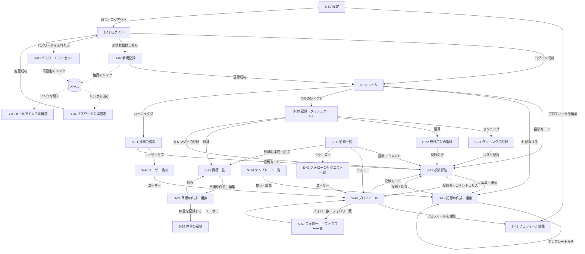

# 画面仕様・画面遷移・ユースケース

[要件定義書](./requirements.md) の詳細ドキュメント。FIT LOG の画面設計をまとめる。機能 ID（F-xx）は [機能要件](./features.md) を参照。

## 画面設計の方針

- **スマートフォンを主に考える**。ジムでトレーニングの合間に記録することが多いため、記録の作成画面（S-13）は片手で、少ない操作で入力できるようにする。パソコンの幅でも崩れないようにする
- 数字の入力欄は、スマートフォンで数字のキーボードが出るようにする（`inputmode="decimal"` / `"numeric"`）
- 重量・距離・ペースは、ユーザーが選んだ単位（F-63）で表示・入力する。この文書の例は kg・km で書く

## 画面仕様

### 画面一覧

| ID | 画面名 | URL（React のルート） | ログイン要否 | 主な機能 |
|---|---|---|---|---|
| S-01 | ログイン | `/login` | 不要 | F-02 |
| S-02 | 新規登録 | `/signup` | 不要 | F-01 |
| S-03 | パスワードのリセット（申請） | `/password-reset` | 不要 | F-08 |
| S-04 | パスワードの再設定 | `/password-reset/confirm?token=…` | 不要 | F-08 |
| S-05 | メールアドレスの確認 | `/verify-email?token=…` | 不要 | F-05, F-06 |
| S-10 | ホーム（タイムライン） | `/`（フォロー中）<br>`/all`（全体） | 必要 | F-20〜F-24, F-12, F-40, F-41 |
| S-11 | 投稿の検索 | `/search?q=…&tag=…&exercise=…` | 必要 | F-25〜F-27, F-21 |
| S-12 | 投稿詳細 | `/workouts/:workoutId` | 必要 | F-13, F-12, F-30〜F-33, F-40, F-41, F-17, F-19, F-85, F-86 |
| S-13 | 記録の作成・編集 | `/workouts/new`（作成）<br>`/workouts/:workoutId/edit`（編集）<br>`/templates/new`・`/templates/:templateId/edit`（テンプレートの編集） | 必要 | F-10, F-11, F-14〜F-19 |
| S-14 | テンプレート一覧 | `/templates` | 必要 | F-18 |
| S-20 | 記録（ダッシュボード） | `/records`（週間）<br>`/records/month`（月間） | 必要 | F-80〜F-82, F-86, F-103 |
| S-21 | ランニングの記録 | `/records/running` | 必要 | F-83 |
| S-22 | 種目ごとの推移 | `/records/exercises`<br>`/records/exercises/:exerciseId` | 必要 | F-84, F-85 |
| S-23 | 目標一覧 | `/goals` | 必要 | F-102, F-103, F-105 |
| S-24 | 目標の作成・編集 | `/goals/new`・`/goals/:goalId/edit` | 必要 | F-100, F-101, F-106 |
| S-25 | 体重の記録 | `/body` | 必要 | F-90〜F-92 |
| S-30 | 通知一覧 | `/notifications` | 必要 | F-111, F-113 |
| S-40 | プロフィール | `/users/:username` | 必要 | F-60, F-62, F-50, F-51, F-57, F-107 |
| S-41 | プロフィール編集 | `/settings/profile` | 必要 | F-61 |
| S-42 | フォロー中・フォロワー一覧 | `/users/:username/following`<br>`/users/:username/followers` | 必要 | F-52, F-50, F-51 |
| S-43 | フォローのリクエスト一覧 | `/follow-requests` | 必要 | F-54〜F-56 |
| S-44 | ユーザー検索 | `/search/users?q=…` | 必要 | F-70, F-71, F-50, F-51 |
| S-50 | 設定 | `/settings` | 必要 | F-63, F-53, F-05〜F-07, F-09 |

- ログインが必要な画面に未ログインでアクセスした場合は、S-01 ログインに移動する。ログインしたら、もとの画面に戻る
- ログイン済みで S-01・S-02・S-03 にアクセスした場合は、S-10 ホームに移動する
- S-04・S-05 は、ログインしていてもしていなくても開ける
- 上の表にない URL を開いた場合は、`/`（ログインしていなければ S-01）に移動する
- トークンを URL に含む画面（S-04・S-05）では、ほかのサイトにトークンが渡らないよう `Referrer-Policy: no-referrer` にし、外部へのリンクを置かない

### 共通部品

#### ナビゲーション（ログイン後の全画面）

幅が 640px を超える画面（パソコン）では上にヘッダーを、640px 以下（スマートフォン）では上に小さいヘッダー・下にタブバーを表示する。

```
パソコン
+----------------------------------------------------------------------+
| FIT LOG  [ホーム] [検索] [記録] [目標]   [+ 記録する]  🔔3  (icon) ▾ |
+----------------------------------------------------------------------+

スマートフォン
+--------------------------------------+
| FIT LOG                  🔔3  (icon) |
+--------------------------------------+
|                                      |
|              （各画面）               |
|                                      |
+--------------------------------------+
|  🏠     🔍     ＋      📊     🎯      |
| ホーム  検索  記録する  記録   目標    |
+--------------------------------------+
```

| 部品 | 内容 |
|---|---|
| ホーム | S-10。表示中にもう一度押すと、最新を取り直して一番上へ |
| 検索 | S-11 投稿の検索（タブでユーザー検索 S-44 に切り替えられる） |
| ＋ 記録する | S-13 記録の作成 |
| 記録 | S-20 ダッシュボード |
| 目標 | S-23 目標一覧 |
| 🔔 と数字 | S-30 通知一覧。未読の数を出す（0 なら数字を出さない、100以上は「99+」）。60秒ごとと、ブラウザのタブが表に戻ったときに取り直す（F-112） |
| (icon) ▾ | 自分のアイコン。押すとメニュー：プロフィール（自分の S-40）・体重の記録（S-25）・テンプレート（S-14）・フォローのリクエスト（S-43。リクエストがあれば数を出す）・設定（S-50）・ログアウト |

- メールアドレスが未確認のときは、ナビゲーションの下に「メールアドレスの確認が済んでいません。届いたメールのリンクを開いてください [確認メールを再送]」を出す（F-05）。閉じるボタンで、その日は出さない
- 体重の記録は個人的な情報なので、タブバーには置かず、アイコンのメニューから開く

#### 投稿カード

タイムライン・検索・プロフィール・投稿詳細で共通して使う。

```
+----------------------------------------------------------+
| (icon) 山田太郎 @yamada · 2026/11/14（金）    🌐   [ … ] |
|        3分前に投稿 · 編集済み                             |
|                                                          |
|  今日は脚の日！ #脚トレ                                    |
|                                                          |
|  ベンチプレス 60kg × 10回 × 3セット       🏆自己ベスト更新 |
|  スクワット 3セット（最大 100kg × 5回）                   |
|  ランニング 5.00km 30:00（6:00/km）                       |
|  ほか 2 種目                                              |
|                                                          |
|  +------------+ +------------+                           |
|  |   画像1    | |   画像2    |                           |
|  +------------+ +------------+                           |
|                                                          |
|  💬 3        💪 12                                        |
+----------------------------------------------------------+
```

| 項目 | 内容 |
|---|---|
| アイコン・表示名・`@ユーザー名` | 押すと投稿者の S-40 へ（[ユーザーへのリンク](#ユーザーへのリンク共通)） |
| 実施日 | 「2026/11/14（金）」の形。今年なら年を省く |
| 投稿日時 | 1時間以内は「◯分前に投稿」、24時間以内は「◯時間前に投稿」、それより前は表示しない（実施日と同じ日に投稿したときも表示しない） |
| 公開範囲のアイコン | 🌐 公開／👥 フォロワー限定／🔒 自分のみ。マウスを乗せる・長押しで名前を出す |
| 編集済み | 一度でも編集した記録だけ（F-11） |
| `…` メニュー | **自分の投稿にだけ**表示。「編集」（S-13）・「この記録を複製」（S-13、F-19）・「テンプレートとして保存」（F-17）・「削除」（F-12、確認ダイアログ） |
| ひとこと | 改行をそのまま表示。ハッシュタグはリンクにして、押すと S-11（`/search?tag=…`）へ（F-26） |
| 種目の要約 | [機能要件の書き方](./features.md#トレーニング記録投稿)どおり。5種目を超えたら「ほか N 種目」。自己ベストを更新した種目には「🏆自己ベスト更新」（F-85） |
| 画像 | 前回の SNS アプリと同じ並べ方（1枚：幅いっぱい・高さ400pxまで、2枚：左右、3枚：左に大きく1枚＋右に2枚、4枚：2×2）。押すと拡大表示（Esc・外側のクリックで閉じる。複数枚は ‹ › と矢印キーで移動） |
| 💬 コメント数 | 押すと S-12 へ移動し、コメント入力欄にカーソルを合わせる。0 なら数字を出さない |
| 💪 ナイストレーニング数 | 押すと付ける・取り消す（F-40, F-41）。付けたときはアイコンの色を変える（F-42）。押した瞬間に画面を先に変え、API が失敗したら元に戻す。0 なら数字を出さない |
| カードの余白 | 押すと S-12 へ |

- **置かないもの**：消費カロリー（本人にも、カードには出さない。S-12 だけ）、リポスト、インプレッション数

#### ユーザーへのリンク（共通）

前回の SNS アプリと同じ。ユーザーのアイコン・表示名・`@ユーザー名` が表示されている場所では、どこでも押すとその人の S-40 へ移動する。部品は1つにまとめ（`<UserLink>`）、投稿カードの中では押しても S-12 への移動が起きないようにする。鍵アカウントには、表示名の横に 🔒 を付ける。

#### ユーザー一覧の行（共通）

S-42・S-43・S-44 で共通。

```
+----------------------------------------------------------+
| (icon) 佐藤花子 🔒 @sato                      [フォロー中] |
|        週4で筋トレしています                               |
+----------------------------------------------------------+
```

| ボタン | 表示する条件 |
|---|---|
| フォローする | まだフォローしていない（F-50） |
| リクエスト中 | 鍵アカウントにリクエストを出している。押すと「リクエストを取り消しますか？」と確認して取り消す（F-57） |
| フォロー中 | フォロー済み。マウスを乗せると「フォロー解除」に変わる。スマートフォンでは押すと「フォローを解除しますか？」と確認する（F-51） |
| （なし） | 自分自身の行 |

#### 期間の切り替え（共通）

S-20・S-21・S-22・S-25 で共通。

```
  [ ‹ ]   2026/11/10（月）〜 11/16（日）   [ › ]   [今週]
```

- ‹ › で前後の期間に移動する。未来の期間には移動できない
- 選んだ期間は URL に入れる（`?week=2026-11-10`・`?month=2026-11`・`?year=2026`）。リロード・ブラウザの「戻る」で同じ期間を表示する

#### グラフ（共通）

- Recharts で描く。グラフの画面（S-20〜S-22・S-25）を開いたときに、グラフの部品を後から読み込む
- 値を押す・マウスを乗せると、その点の値を表示する
- 画面の読み上げのため、グラフと同じ内容の表を「表で見る」で開けるようにする
- データがないときは、グラフの代わりに「この期間の記録はありません」と表示する

#### 確認ダイアログ・お知らせ（共通）

- 削除などの取り消せない操作は、確認ダイアログを出す。ダイアログは Esc・「キャンセル」で閉じる
- 保存・削除のあとは、画面の下に短いお知らせ（「記録を投稿しました」など）を3秒出す
- 通信に失敗したときは、お知らせで「通信に失敗しました。もう一度お試しください」と出し、入力した内容は消さない

### 各画面

#### S-01 ログイン

前回の SNS アプリと同じ。ただし「パスワードを忘れた方」のリンクを足す。

```
+--------------------------------------+
|               FIT LOG                |
|                                      |
|  メールアドレス                       |
|  [                              ]    |
|  パスワード                           |
|  [                              ]    |
|                                      |
|  [          ログイン            ]    |
|                                      |
|  パスワードを忘れた方                 |
|  アカウントをお持ちでない方は         |
|  新規登録はこちら                     |
+--------------------------------------+
```

| 項目 | 種類 | 必須 | チェック |
|---|---|---|---|
| メールアドレス | テキスト | ○ | 空でないこと |
| パスワード | パスワード | ○ | 空でないこと |

- 失敗時は「メールアドレスまたはパスワードが正しくありません」と表示する（どちらが違うかは教えない）

#### S-02 新規登録

前回の SNS アプリと同じ。

| 項目 | 必須 | チェック |
|---|---|---|
| ユーザー名 | ○ | 半角英数字と `_`、4〜15文字、重複不可 |
| 表示名 | ○ | 1〜50文字 |
| メールアドレス | ○ | メール形式、重複不可 |
| パスワード | ○ | 8〜72文字 |
| パスワード（確認） | ○ | パスワードと一致（画面だけでチェック） |

- 登録したら S-10 へ移動し、「確認のメールを送りました。メールのリンクを開いて、メールアドレスの確認を済ませてください」と表示する

#### S-03 パスワードのリセット（申請）

```
+--------------------------------------+
|        パスワードのリセット           |
|                                      |
|  登録したメールアドレスを入力すると、  |
|  パスワードを再設定するためのリンクを  |
|  お送りします。                       |
|                                      |
|  メールアドレス                       |
|  [                              ]    |
|                                      |
|  [         メールを送る          ]    |
|                                      |
|  ログインに戻る                       |
+--------------------------------------+
```

- 送ったあとは、入力したアドレスが登録されているかどうかに関係なく「入力したメールアドレスが登録されていれば、再設定のリンクを送りました。30分以内に開いてください」と表示する

#### S-04 パスワードの再設定

```
+--------------------------------------+
|        新しいパスワードの設定         |
|                                      |
|  新しいパスワード                     |
|  [                              ]    |
|  新しいパスワード（確認）             |
|  [                              ]    |
|                                      |
|  [       パスワードを変更する     ]    |
+--------------------------------------+
```

| 項目 | 必須 | チェック |
|---|---|---|
| 新しいパスワード | ○ | 8〜72文字 |
| 新しいパスワード（確認） | ○ | 一致すること（画面だけでチェック） |

- 変更したら S-01 へ移動し、「パスワードを変更しました。新しいパスワードでログインしてください」と表示する
- リンクの期限切れ・使用済み・不正なときは「このリンクは使えません。もう一度リセットを申請してください」と、S-03 へのリンクを表示する

#### S-05 メールアドレスの確認

- 開くとすぐに確認の API を呼び、結果を表示する
  - 成功：「メールアドレスの確認が済みました」（メールアドレスの変更の確認なら「メールアドレスを変更しました」）。ログインしていれば「ホームへ」、していなければ「ログインへ」のボタン
  - 失敗（期限切れ・使用済み・不正）：「このリンクは使えません」。ログインしていれば「確認メールを再送」ボタン

#### S-10 ホーム（タイムライン）

```
+----------------------------------------------------------+
| ナビゲーション                                            |
+----------------------------------------------------------+
|   [ フォロー中 ]  [ 全体 ]                               |
+----------------------------------------------------------+
|  今週 3日 / 目標 4日  ███████░░░  75%     記録を見る ›    |
+----------------------------------------------------------+
|              [ ↑ 3件の新しい投稿 ]                        |
| 投稿カード                                                |
+----------------------------------------------------------+
| 投稿カード                                                |
+----------------------------------------------------------+
| ...（20件。下までスクロールすると次の20件が続く）          |
+----------------------------------------------------------+
```

| タブ | URL | 表示する投稿 | 機能 |
|---|---|---|---|
| フォロー中（初期表示） | `/` | 自分と、承認済みのフォロー相手の、見てよい投稿 | F-20 |
| 全体 | `/all` | 全ユーザーの、見てよい投稿 | F-22 |

- 投稿日時の新しい順に20件。下までスクロールすると次の20件を自動で足す（F-21）。最後まで読むと「これ以上の投稿はありません」
- **今週のひとこと**：一番上に、自分の今週のトレーニング日数を出す。頻度の目標（毎週）があれば、その達成率のバーも出す。押すと S-20 へ。自分にしか見えない
- 新しい投稿のお知らせ（F-24）：60秒ごとに新しい投稿の件数だけを確認し、あればタブの下に「↑ N件の新しい投稿」（99件を超えたら「99+件」）を出す。押すか、表示中のタブ・ナビの「ホーム」をもう一度押すと、最新の20件を取り直して一番上へ。ブラウザのタブが裏にある間は確認しない
  - 前回はモーダルでも知らせたが、今回はボタンだけにする（記録を読んでいる途中で邪魔にならないように）
- 投稿が0件のとき
  - フォロー中：「まだ記録がありません。最初の記録をつけてみましょう [＋ 記録する]」「ユーザーを検索して、仲間をフォローしてみましょう」
  - 全体：「まだ誰も記録していません」

#### S-11 投稿の検索

```
+----------------------------------------------------------+
| ナビゲーション                                            |
+----------------------------------------------------------+
|   [ 投稿 ]  [ ユーザー ]                                 |
|  [ 🔍 キーワード                                  ] [×]  |
|  種目: [ すべて ▾ ]                                       |
|  #脚トレ ×                                                |
+----------------------------------------------------------+
| 「#脚トレ」の投稿                                         |
| 投稿カード                                                |
+----------------------------------------------------------+
| 投稿カード                                                |
+----------------------------------------------------------+
```

| 項目 | 内容 |
|---|---|
| タブ | 「投稿」（S-11）・「ユーザー」（S-44）。切り替えても入力したキーワードは残す |
| キーワード | 1〜50文字。入力が止まってから0.3秒後に検索する（Enter でもすぐ）。× でクリア（F-25） |
| 種目 | 種目を1つ選ぶ。選ぶ部品は S-13 の種目の選択と同じ（F-27） |
| ハッシュタグ | 投稿カードのハッシュタグから来たとき、または `#` から始まる語をキーワードに入れたときに、条件として「#脚トレ ×」の形で出す。× で外す（F-26） |
| URL | 条件を変えるたびに `/search?q=…&tag=…&exercise=…` に変える |
| 条件が何もないとき | 「キーワード・ハッシュタグ・種目で記録を探せます」と、自分がよく使うハッシュタグ（直近の自分の投稿から最大10個）を出す |
| 結果 | 見てよい投稿を、投稿日時の新しい順に20件ずつ。下までスクロールで続きを読み込む |
| 0件のとき | 「条件に合う記録は見つかりませんでした」 |

- 検索中は結果の欄に読み込み中の表示を出す。先に送った検索の結果が後から届いたら捨てる（前回と同じ）

#### S-12 投稿詳細

```
+----------------------------------------------------------+
| ナビゲーション                                            |
+----------------------------------------------------------+
| ← 記録                                                    |
+----------------------------------------------------------+
| (icon) 山田太郎 @yamada · 2026/11/14（金）     🌐  [ … ] |
|  今日は脚の日！ #脚トレ                                    |
|  トレーニング時間 75分                                     |
|                                                          |
|  ■ スクワット（脚）                       🏆自己ベスト更新 |
|     1   60kg × 10回                                       |
|     2   80kg × 8回                                        |
|     3  100kg × 5回   🏆                                   |
|  ■ ランニング（有酸素）                                   |
|     1   5.00km  30:00   6:00/km                           |
|                                                          |
|  [画像]                                                   |
|                                                          |
|  🔥 消費カロリーの目安 約 520kcal     ← 本人だけ           |
|                                                          |
|  💬 3        💪 12                                        |
+----------------------------------------------------------+
| [ コメントを入力                                        ] |
|                                    12 / 140 [コメントする] |
+----------------------------------------------------------+
| (icon) 佐藤花子 @sato · 2分前                [返信] [削除] |
|   フォームきれいでした！                                   |
|    └ (icon) 山田太郎 @yamada · 1分前              [削除]  |
|        @sato ありがとうございます！                         |
|    [返信を入力                               ] [返信する] |
+----------------------------------------------------------+
| (icon) 鈴木一郎 @suzuki · 1分前                    [返信] |
|   ナイスです                                              |
+----------------------------------------------------------+
|                    [ さらに表示 ]                          |
+----------------------------------------------------------+
```

| 項目 | 内容 |
|---|---|
| ← | 直前の画面に戻る（戻る先がなければ S-10） |
| 種目とセット | すべての種目とセットを並び順に表示する。種目の名前の横に部位。重量 × 回数の種目は、自己ベストを更新したセットに 🏆 |
| 消費カロリー | **本人の記録のときだけ**表示する（F-86）。体重の記録がないときは「体重を記録すると消費カロリーの目安が表示されます [体重を記録する]」。トレーニング時間がないときは「有酸素の分だけの目安です。トレーニング時間を入れると筋トレの分も計算します」と書き添える |
| `…` メニュー | 投稿カードと同じ |
| コメント | 返信元のコメントを古い順に20件、その下に返信を古い順に表示する。続きは「さらに表示」で20件ずつ（F-31） |
| コメントの入力 | 1〜140文字。入力した文字数を「12 / 140」で表示し、超えたら赤字にしてボタンを押せなくする（F-30） |
| 返信 | 「返信」を押すと、その下に返信の入力欄を出す。返信への「返信」も、同じ返信元の下に入力欄を出し、入力欄の先頭に `@ユーザー名` を入れておく（F-33） |
| 削除 | 自分のコメントと、自分の投稿へのコメントに表示する。確認ダイアログのあとに削除する。返信元を削除するときは「返信も削除されます」と書き添える（F-32） |
| 見られない投稿 | 削除済み・存在しない・見る権限がないときは、どれも「この記録は見つかりません」 |

- 「自分のみ」の投稿には、本人だけがナイストレーニング・コメントできる（自分の記録へのメモとして）。コメントの入力欄の見出しを「メモを書く」にする

#### S-13 記録の作成・編集

ジムで使うことを考え、スマートフォンで1画面ずつ縦に並べる。

```
+--------------------------------------+
| × 新しい記録              [投稿する] |
+--------------------------------------+
| [📋 テンプレートから] [⧉ 前回の記録] |
|                                      |
| 実施日   [ 2026/11/14（金） ▾ ]       |
| 時間     [  75 ] 分（任意）           |
|                                      |
| ■ スクワット（脚）        [↑][↓][…]  |
|   # 重量(kg)     回数                 |
|   1 [ 60    ]  [ 10 ]          [×]   |
|   2 [ 80    ]  [  8 ]          [×]   |
|   3 [100    ]  [  5 ]          [×]   |
|   [＋ セットを追加]                   |
|                                      |
| ■ ランニング（有酸素）    [↑][↓][…]  |
|   # 時間          距離(km)            |
|   1 [0:30:00]    [ 5.00 ]       [×]  |
|   [＋ セットを追加]                   |
|                                      |
| [＋ 種目を追加]                       |
|                                      |
| ひとこと                              |
| [今日は脚の日！ #脚トレ          ]    |
|                          18 / 280    |
| 画像  [＋] [画像1 ×]                  |
| 公開範囲  (●)🌐公開 ( )👥フォロワー   |
|           ( )🔒自分のみ               |
+--------------------------------------+
```

| 項目 | 内容 |
|---|---|
| テンプレートから | 自分のテンプレートの一覧から選ぶ（F-19）。入力中の種目があれば「入力中の種目とセットを置き換えます」と確認する |
| 前回の記録 | 自分の直近の記録10件から選んで、その種目とセットを入れる（F-19）。選ぶ一覧には実施日と種目の要約を出す |
| 実施日 | 初期値は今日。未来の日付は選べない |
| 時間 | トレーニング時間（分、任意）。1〜1440 |
| 種目の追加 | 「＋ 種目を追加」で種目の選択を開く（下記）。選ぶと、セットを1つ入れた状態で一番下に足す |
| 種目の `…` | 「種目を変える」（記録方式が同じ種目だけ。セットはそのまま）・「削除」 |
| ↑ ↓ | 種目の並べ替え。セットにも長押しのメニューで「上へ」「下へ」を出す |
| セットの入力 | 記録方式に合わせて欄を出す（重量 × 回数／回数のみ／時間・距離）。重量の単位は設定の単位。時間は「時:分:秒」（「30:00」のように分:秒でも入力できる） |
| ＋ セットを追加 | **直前のセットと同じ値を入れて**足す（同じ重さで何セットもするため）。一番上のセットなら空で足す |
| ひとこと | 280文字まで。数を「18 / 280」で表示する |
| 画像 | 4枚まで。選んだら、ブラウザで縮小してからプレビューを出す。× で外す。縮小できない形式・20MBを超える画像は「この画像は使えません（JPEG・PNG・WebP、20MBまで）」 |
| 公開範囲 | 初期値は「公開」。鍵アカウントのときは「公開」の説明に「鍵アカウントなので、承認したフォロワーだけに見えます」と書き添える |
| 投稿する | 必須項目がそろうまで押せない。押したら API に送り、成功したら S-12 へ移動して「記録を投稿しました」。自己ベストを更新した種目があれば「🏆 スクワットの自己ベストを更新しました！」と表示する |
| × | 入力中の内容があれば「入力中の記録は保存されません。閉じますか？」と確認して、前の画面に戻る |

種目の選択（作成画面の上に全画面で開く）：

```
+--------------------------------------+
| ← 種目を選ぶ                          |
| [ 🔍 種目を検索                   ]   |
| [すべて][胸][背中][脚][肩][腕][腹]... |
+--------------------------------------+
| 最近使った種目                        |
|   スクワット（脚）                     |
|   ベンチプレス（胸）                   |
| 脚                                    |
|   スクワット                          |
|   レッグプレス                        |
|   ブルガリアンスクワット ★自分専用      |
|   ...                                |
+--------------------------------------+
| 見つからないとき [＋ 自分専用の種目を追加] |
+--------------------------------------+
```

- 一番上に、自分が最近使った種目を10件まで出す
- 名前の部分一致（入力しながら絞り込む。大文字・小文字・全角半角は区別しない）と部位で絞り込む（F-14）
- 「＋ 自分専用の種目を追加」で、名前（検索欄の文字を入れておく）・部位・記録方式を入力して追加する（F-15）。追加したらそのまま選んだことにする
- 自分専用の種目の行には ★ を付け、長押し・右クリックで「名前・部位を変える」「削除」を出す（F-16）。記録で使っている種目の「削除」は「記録で使っている種目は削除できません」と表示する

入力のチェック（画面でもサーバーでも同じ決まり。詳しくは [機能要件](./features.md#トレーニング記録投稿)）：

| 項目 | チェック |
|---|---|
| 種目 | 1〜20件 |
| セット | 種目ごとに1〜20件 |
| 重量 | 0.25〜500kg（0.25 刻み）／0.5〜1100lb（0.5 刻み） |
| 回数 | 重量 × 回数：0〜999、回数のみ：1〜9999 |
| 時間 | 1秒〜24時間 |
| 距離 | 空か、0.01〜500km（マイルも 0.01 刻み） |

- 入力が範囲を外れたら、その欄の下に赤字で理由を出す（例：「0.25kg 刻みで入力してください」）
- **入力中の内容の一時保存**：作成中の内容は、入力のたびに端末（ブラウザの localStorage）に保存する。画面を閉じたり、スマートフォンの画面が消えて読み込み直したりしても、次に S-13 を開いたときに「書きかけの記録があります。続きから入力しますか？ [続ける] [破棄する]」と出す。投稿したとき・破棄したときに消す。画像は保存しない（「画像は選び直してください」と書く）
- **編集**のときは、今の内容が入った状態で開く。ボタンは「保存する」。テンプレート・前回の記録の呼び出しは出さない。一時保存はしない
- **テンプレートの編集**（`/templates/…`）のときは、同じ部品で、名前（1〜30文字）・種目・セットだけを入力する。ボタンは「テンプレートを保存」

#### S-14 テンプレート一覧

```
+----------------------------------------------------------+
| ← テンプレート                         [＋ 新しく作る]    |
+----------------------------------------------------------+
| 脚の日                                     [使う] [ … ]   |
|   スクワット・レッグプレス・カーフレイズ（3種目）          |
+----------------------------------------------------------+
| 胸の日                                     [使う] [ … ]   |
|   ベンチプレス・ダンベルフライ（2種目）                    |
+----------------------------------------------------------+
```

- 「使う」で、そのテンプレートを入れた状態で S-13 を開く
- `…` で「編集」（S-13 のテンプレートの編集）・「削除」（確認ダイアログ）
- 20件あるときは「＋ 新しく作る」を押せなくし、「テンプレートは20件までです」と出す
- 0件のとき：「よく行うメニューを保存しておくと、記録するときに呼び出せます」

#### S-20 記録（ダッシュボード）

```
+----------------------------------------------------------+
| ナビゲーション                                            |
+----------------------------------------------------------+
|  [ 週間 ]  [ 月間 ]                     ランニング › 種目 ›|
|  [ ‹ ]  2026/11/10（月）〜 11/16（日）  [ › ]  [今週]      |
+----------------------------------------------------------+
|  トレーニング日数   総挙上量        運動時間    距離       |
|  4日 (+1)          12,450kg(+800)  95分(-10)  15.0km(+3)  |
|  消費カロリー  約 2,150kcal (+300)                         |
+----------------------------------------------------------+
|  曜日ごと  [総挙上量 | 運動時間]                           |
|   ▇    ▇         ▇    ▇                                   |
|   月 火 水 木 金 土 日                                      |
+----------------------------------------------------------+
|  部位別のセット数                                          |
|   胸 ████████ 12 (30%)                                    |
|   脚 ██████   9 (23%)                                     |
|   ...                                                     |
+----------------------------------------------------------+
|  目標                                       すべて見る ›   |
|   週4日トレーニング     ████████░░  3/4日  75%            |
|   月間ランニング 100km  ███░░░░░░░  35/100km 35%          |
+----------------------------------------------------------+
|  カレンダー     [ ‹ ] 2026年11月 [ › ]                     |
|   月 火 水 木 金 土 日                                      |
|                        1  2                               |
|    3  4● 5  6● 7  8  9                                    |
|   ...                                                     |
+----------------------------------------------------------+
```

| 部分 | 内容 |
|---|---|
| 週間・月間のタブ | 週間 `/records?week=…`（F-80）・月間 `/records/month?month=…`（F-81） |
| 集計値 | トレーニング日数・総挙上量・運動時間・距離・消費カロリー。かっこの中は前の期間との差（増えたら＋、減ったら−。色だけでなく記号でも分かるようにする） |
| 消費カロリー | 体重の記録がない日の記録を除いたときは「※ 体重の記録がない日を除く」と書き添える |
| グラフ | 週間：曜日ごとの棒グラフ（総挙上量・運動時間を切り替える）。月間：週ごとの推移グラフ |
| 部位別のセット数 | 部位ごとのセット数と割合の横棒 |
| 目標 | 達成済み以外の目標を最大3件（期限・期間が近い順）。押すと S-23 |
| カレンダー | 月のカレンダー（F-82）。記録した日に ● を付ける。日付を押すと、下にその日の自分の記録を一覧で出す（投稿カード）。週間・月間のタブとは別に月を動かせる |
| ランニング › ・種目 › | S-21・S-22 へ |
| 記録が1件もないとき | 「記録をつけると、ここに週・月の集計が表示されます [＋ 記録する]」 |

#### S-21 ランニングの記録

```
+----------------------------------------------------------+
| ← ランニング                                              |
|  [ 週間 ] [ 月間 ] [ 年間 ]                               |
|  [ ‹ ]  2026年11月  [ › ]  [今月]                         |
+----------------------------------------------------------+
|  走行距離      走行時間       回数    平均ペース            |
|  45.20km       4:31:10        8回     6:00/km              |
|  (+5.10)       (+0:25:00)     (+1)    (-0:08)              |
+----------------------------------------------------------+
|  ベスト記録                                                |
|   ⚡ 最速ペース  5:12/km（10.00km・11/8）        ›         |
|   📏 最長距離    15.00km（1:35:20・11/3）        ›         |
+----------------------------------------------------------+
|  （年間のとき）月ごとの走行距離                             |
|   ▇ ▇ ▇ ▇ ▇ ▇ ▇ ▇ ▇ ▇ ▇                                   |
+----------------------------------------------------------+
```

- 週間 `?period=week&date=…`・月間 `?period=month&date=…`・年間 `?period=year&date=…`（F-83）
- ペースは「分:秒/km」（マイル表示なら「/mi」）。前の期間との差のペースは、速くなったら −（例：−0:08）と表示し、「速くなった」と分かる色にする
- ベスト記録を押すと、その記録の S-12 へ
- 最速ペースは 1km 以上の記録だけが対象であることを「（1km 以上の記録から）」と小さく書く
- ランニングの記録がない期間は「この期間のランニングの記録はありません」

#### S-22 種目ごとの推移

```
+----------------------------------------------------------+
| ← 種目ごとの推移                                          |
|  種目: [ ベンチプレス ▾ ]                                 |
|  [ 3か月 ] [ 1年 ] [ 全期間 ]                              |
+----------------------------------------------------------+
|  🏆 自己ベスト 100kg（2026/10/20）                         |
|  推定 1RM の最大 112.5kg（2026/11/02）                     |
+----------------------------------------------------------+
|  [ 最大重量 | 推定 1RM ]                                   |
|            ●                                              |
|       ●  ●   ●                                            |
|   ●  ●                                                    |
|   9/1      10/1      11/1                                 |
+----------------------------------------------------------+
|  記録の一覧（新しい順）                                    |
|   11/14  最大 95kg × 3回  推定 1RM 104.5kg            ›   |
|   ...                                                     |
+----------------------------------------------------------+
```

- `/records/exercises` では、自分が記録した種目の一覧（部位ごと、最後に記録した日つき）を出し、選ぶと `/records/exercises/:exerciseId` へ
- 表示する値は記録方式で変わる（F-84）。回数のみ：合計回数・最大回数、時間・距離：合計時間・合計距離（ランニングはペースも）
- 期間は URL に入れる（`?range=3m|1y|all`）
- 一覧の行を押すと、その記録の S-12 へ
- 推定 1RM には「推定値です（1〜10回のセットから Epley 式で計算）」と書き添える

#### S-23 目標一覧

```
+----------------------------------------------------------+
| ナビゲーション                                            |
+----------------------------------------------------------+
| 目標                                     [＋ 目標を作る]   |
|  [ 進行中 ]  [ 達成済み ]                                  |
+----------------------------------------------------------+
| 週4日トレーニング         毎週    👥 応援 3        [ … ]   |
|   今週 ████████░░  3/4日  75%                             |
|   これまで：達成 6週 / 8週                       履歴 ›    |
+----------------------------------------------------------+
| ベンチプレス 100kg        〜2026/12/31  🔒     [ … ]       |
|   ████████▉░  95/100kg  95%                               |
+----------------------------------------------------------+
| 体重 70kg                 期限なし       🔒    [ … ]       |
|   ████░░░░░░  開始 75.0kg → 今 73.0kg  40%                |
+----------------------------------------------------------+
```

| 部分 | 内容 |
|---|---|
| 進行中 | 達成済み以外の目標。期限切れの目標は「期限切れ」の印を付けて一番下に並べる |
| 達成済み | 重量・体重の目標の達成日つきの一覧と、くり返しの目標の週・月ごとの達成の履歴（F-105） |
| 達成率 | 0〜100% のバー（F-103）。100% を超えても 100% で止める |
| 公開範囲・応援 | 公開範囲のアイコンと、応援の数（応援があるとき） |
| `…` | 「編集」（S-24）・「削除」（確認ダイアログ。「応援も消えます」と書き添える）（F-102） |
| 10件のとき | 「＋ 目標を作る」を押せなくし、「進行中の目標は10件までです」と出す |
| 0件のとき | 「目標を立てて、続ける力にしましょう [＋ 目標を作る]」 |

- 達成したときの通知を押すと、この画面の「達成済み」を開く

#### S-24 目標の作成・編集

```
+--------------------------------------+
| × 目標を作る                [保存する] |
+--------------------------------------+
| 種類                                  |
|  (●) 頻度   週・月に何日トレーニングするか |
|  ( ) 量     週・月の合計（距離など）     |
|  ( ) 重量   種目の重さ               |
|  ( ) 体重                            |
|                                      |
| 期間   (●) 毎週  ( ) 毎月             |
| 目標   [  4 ] 日                      |
|                                      |
| 名前   [週4日トレーニング          ]   |
|                                      |
| 公開範囲 ( )🌐公開 ( )👥フォロワー     |
|          (●)🔒自分のみ                |
+--------------------------------------+
```

種類ごとの入力欄：

| 種類 | 入力欄 |
|---|---|
| 頻度 | 期間（毎週／毎月）・目標の日数（毎週 1〜7、毎月 1〜31） |
| 量 | 期間（毎週／毎月）・何の合計か（総挙上量・運動時間・距離）・目標値・絞り込み（なし／種目1つ／部位1つ） |
| 重量 | 種目（「重量 × 回数」の種目だけ選べる）・目標の重さ・期限（任意）。今の自己ベストを「今の自己ベスト：95kg」と出す |
| 体重 | 目標の体重・期限（任意）。開始時の体重を「開始時の体重：75.0kg（11/14 の記録）」と出す。体重の記録がないときは「先に体重を記録してください [体重を記録する]」として作れなくする |

- 名前は入力に合わせて自動で入れる。自分で書き換えたら、それ以降は自動で変えない
- 体重の目標では公開範囲を出さない（「体重の目標は自分だけが見られます」と書く）
- 公開範囲で「公開」「フォロワー限定」を選んだとき、量の目標なら「達成率から合計がおおよそ分かります」と書き添える
- 編集のときは種類を変えられない（種類の欄は表示だけ）

#### S-25 体重の記録

```
+----------------------------------------------------------+
| ← 体重の記録                     🔒 自分だけが見られます   |
+----------------------------------------------------------+
|  日付 [ 2026/11/14 ▾ ]                                    |
|  体重 [ 73.0 ] kg    体脂肪率 [ 18.5 ] %（任意）           |
|                                          [記録する]       |
+----------------------------------------------------------+
|  [ 3か月 ] [ 1年 ]                                         |
|   体重 ─  体脂肪率 ┄                                       |
|   ●──●──●─●──●                                            |
+----------------------------------------------------------+
|  記録の一覧                                                |
|   11/14  73.0kg  18.5%                          [削除]    |
|   11/13  73.4kg  —                              [削除]    |
+----------------------------------------------------------+
```

- 同じ日付の記録があるときは、入力欄に今の値を入れ、ボタンを「上書きする」にする（F-90）
- 一覧は日付の新しい順に30件ずつ。「さらに表示」で続き（F-91）
- 削除は確認ダイアログのあとに行う。体重の目標の開始時の体重に使っている記録を消したときは、次に近い記録を開始時の体重にする（「体重の目標の開始時の体重が変わります」と確認ダイアログに書く）
- グラフは体重と体脂肪率の2本（右と左で別の目盛り）（F-92）

#### S-30 通知一覧

```
+----------------------------------------------------------+
| ← 通知                                                    |
+----------------------------------------------------------+
| ● (icon) 佐藤花子さんがあなたの記録にナイストレーニング    |
|          しました「今日は脚の日！…」 · 3分前               |
+----------------------------------------------------------+
| ● 🎯 目標「ベンチプレス 100kg」を達成しました · 1時間前    |
+----------------------------------------------------------+
|   (icon) 鈴木一郎さんからフォローのリクエストが届きました  |
|          · 昨日                    [承認] [拒否]          |
+----------------------------------------------------------+
```

- 新しい順に20件。下までスクロールで続き（F-111）
- 未読の通知には ● を付け、背景の色を変える。開いたときに、表示した通知を既読にする（F-113）。● は画面を離れるまで残す（どれが新しかったか分かるように）
- 押すと、対象の画面へ移動する（投稿→S-12、コメント・返信→S-12 の該当コメント、フォロー→S-40、リクエスト→S-43、目標の達成→S-23、応援→S-23）
- フォローのリクエストの通知には、その場で「承認」「拒否」のボタンを出す
- 0件のとき：「通知はまだありません」

#### S-40 プロフィール

```
+----------------------------------------------------------+
| ← 山田太郎                                                |
+----------------------------------------------------------+
|  (大きいicon)                    [プロフィールを編集]       |
|  山田太郎 🔒                       または [フォローする]    |
|  @yamada                                                  |
|  週4で筋トレしています                                     |
|  12 フォロー中   8 フォロワー                              |
+----------------------------------------------------------+
|  公開している目標                                          |
|   月間ランニング 100km  ████░░░░░░ 40%     [📣 応援する 3] |
+----------------------------------------------------------+
|  記録                                                     |
|  投稿カード（実施日の新しい順）                            |
+----------------------------------------------------------+
```

| ボタン | 表示する条件 |
|---|---|
| プロフィールを編集 | 自分のプロフィール（S-41 へ） |
| フォローする／リクエスト中／フォロー中 | 他人のプロフィール（[ユーザー一覧の行](#ユーザー一覧の行共通)と同じ動き）。鍵アカウントには「フォローをリクエスト」と表示する |

- 「◯ フォロー中」「◯ フォロワー」を押すと S-42 へ（鍵アカウントで見る権限がないときは押せない）
- **公開している目標**：見てよい目標を最大3件と「すべて見る」。目標ごとに「📣 応援する」ボタン（押すと応援、もう一度で取り消し。F-107）と応援の数。自分のプロフィールでは応援ボタンの代わりに数だけ
- **記録**：見てよい投稿を実施日の新しい順に20件ずつ（F-62）
- 鍵アカウントで、承認されたフォロワーでないとき：目標と記録の代わりに「🔒 このアカウントの記録は、承認されたフォロワーだけが見られます」
- 存在しないユーザー名・退会したユーザーのとき：「このアカウントは存在しません」

#### S-41 プロフィール編集

前回の SNS アプリと同じ。ただし、アイコン画像は JPEG・PNG・WebP で、ブラウザで縮小（512px 四方）してから送る。メールアドレスの変更は S-50 で行う。

| 項目 | 必須 | チェック |
|---|---|---|
| アイコン画像 | － | JPEG・PNG・WebP、選べるのは20MBまで |
| 表示名 | ○ | 1〜50文字 |
| 自己紹介 | － | 160文字まで |

#### S-42 フォロー中・フォロワー一覧

前回の SNS アプリと同じ。行は[ユーザー一覧の行](#ユーザー一覧の行共通)を使う。

- 承認済みの相手だけを表示する
- 鍵アカウントの一覧は、本人と承認済みのフォロワーだけが見られる。見られないときは「🔒 このアカウントのフォロー・フォロワーは、承認されたフォロワーだけが見られます」

#### S-43 フォローのリクエスト一覧

```
+----------------------------------------------------------+
| ← フォローのリクエスト                                    |
+----------------------------------------------------------+
| (icon) 鈴木一郎 @suzuki                   [承認] [拒否]   |
|        ランニング好きです                                  |
+----------------------------------------------------------+
```

- 自分へのリクエストを新しい順に20件ずつ（F-54）
- 「承認」で相手がフォロワーになり、行を消す（F-55）。「拒否」は確認ダイアログのあとに行を消す（F-56）。どちらも元に戻す操作は用意しない（拒否した相手は、もう一度リクエストを出せる）
- 鍵アカウントでないときに開いた場合：「鍵アカウントにすると、フォローを承認制にできます [設定へ]」
- 0件のとき：「フォローのリクエストはありません」

#### S-44 ユーザー検索

前回の SNS アプリの「ユーザー検索」と同じ。ただし、S-11 と同じ画面の「ユーザー」タブとして表示する。行は[ユーザー一覧の行](#ユーザー一覧の行共通)を使う。

- キーワードが空のときは「最近参加したユーザー」を表示する（F-71）

#### S-50 設定

```
+----------------------------------------------------------+
| ← 設定                                                    |
+----------------------------------------------------------+
|  単位                                                     |
|   重量  (●) kg  ( ) lb                                    |
|   距離  (●) km  ( ) マイル                                 |
+----------------------------------------------------------+
|  プライバシー                                              |
|   鍵アカウント  [  ○ ]                                     |
|   オンにすると、フォローを承認制にします。                   |
+----------------------------------------------------------+
|  アカウント                                                |
|   メールアドレス  yamada@example.com（確認済み）  [変更]   |
|   パスワード                                   [変更]     |
|   プロフィール                                 [編集] ›   |
+----------------------------------------------------------+
|  [ログアウト]                                              |
|  [退会する]                                               |
+----------------------------------------------------------+
```

| 項目 | 内容 |
|---|---|
| 単位 | 選んだらすぐ保存する（F-63）。すべての画面の表示がすぐに切り替わる |
| 鍵アカウント | オンにするときは「承認したフォロワーだけが、あなたの記録と目標を見られるようになります。今のフォロワーはそのままです」、オフにするときは「承認待ちのリクエスト（N件）はすべて承認されます」と確認する（F-53） |
| メールアドレスの変更 | 新しいメールアドレスと今のパスワードを入力する。送ったら「新しいメールアドレスに確認のメールを送りました。リンクを開くと変更されます」（F-06）。未確認のときは「確認メールを再送」も出す |
| パスワードの変更 | 今のパスワード・新しいパスワード（8〜72文字）・新しいパスワード（確認）を入力する（F-07）。変更したら「パスワードを変更しました。ほかの端末ではログアウトされます」 |
| 退会 | 「退会すると、記録・体重・目標などすべてのデータが削除され、元に戻せません」と書いた画面でパスワードを入力し、「退会する」で実行する（F-09）。退会したら S-01 へ移動し、「退会しました」と表示する |

## 画面遷移



ナビゲーションから、どの画面からでも「ホーム（S-10）」「検索（S-11）」「記録する（S-13）」「記録（S-20）」「目標（S-23）」「通知（S-30）」に移動できる。アイコンのメニューから「プロフィール（自分の S-40）」「体重の記録（S-25）」「テンプレート（S-14）」「フォローのリクエスト（S-43）」「設定（S-50）」「ログアウト」に移動できる。

## ユースケース／操作フロー

### 認証・アカウント

| ID | ユースケース | 操作フロー | 結果 |
|---|---|---|---|
| UC-01 | アカウントを作る | S-01「新規登録はこちら」→ S-02 で入力 →「登録する」 | ログイン状態で S-10 が表示され、確認のメールが届く |
| UC-02 | メールアドレスを確認する | 届いたメールのリンクを開く（S-05） | 「確認が済みました」と表示され、ナビゲーションの下の案内が消える |
| UC-03 | ログインする・ログアウトする | S-01 で入力 →「ログイン」／アイコンのメニューの「ログアウト」 | S-10 が表示される／S-01 に戻る |
| UC-04 | パスワードを忘れたときに再設定する | S-01「パスワードを忘れた方」→ S-03 でメールアドレスを入力 → 届いたメールのリンク → S-04 で新しいパスワードを入力 | S-01 に戻り、新しいパスワードでログインできる。ほかの端末はログアウトされる |
| UC-05 | パスワード・メールアドレスを変える | S-50 の「変更」→ 入力（メールアドレスは、新しいアドレスに届いたリンクを開く） | パスワード：ほかの端末はログアウトされる。メールアドレス：リンクを開いたときに変わる |
| UC-06 | 退会する | S-50「退会する」→ パスワードを入力 →「退会する」 | すべてのデータが消え、S-01 に戻る |
| UC-07 | 再訪問時にログイン状態を保つ | ブラウザでアプリを開き直す | リフレッシュトークンが有効（最後の再発行から14日以内）ならログインしたまま S-10 が表示される |

### 記録する

| ID | ユースケース | 操作フロー | 結果 |
|---|---|---|---|
| UC-10 | 筋トレを記録する | 「＋ 記録する」→ S-13「＋ 種目を追加」→ 種目を選ぶ → 重量・回数を入力し「＋ セットを追加」をくり返す → 公開範囲を選ぶ →「投稿する」 | S-12 が表示される。自己ベストを更新した種目があれば知らされる |
| UC-11 | ランニングを記録する | S-13 で「ランニング」を選ぶ → 時間・距離を入力 →「投稿する」 | 記録の詳細にペースが表示され、S-21 の集計に入る |
| UC-12 | 記録し忘れた日の分を登録する | S-13 で実施日を過去の日にする →「投稿する」 | その日の記録として集計・カレンダーに入る。タイムラインには新しい投稿として出る |
| UC-13 | テンプレートで記録する | S-13「📋 テンプレートから」→ テンプレートを選ぶ → 値を直す →「投稿する」 | テンプレートの種目とセットが入った状態から記録できる |
| UC-14 | 前回と同じメニューで記録する | S-13「⧉ 前回の記録」→ 記録を選ぶ（または S-12 の `…` →「この記録を複製」） | 前回の種目とセットが入った状態から記録できる |
| UC-15 | よく行うメニューをテンプレートにする | S-12 の `…` →「テンプレートとして保存」→ 名前を入力 | S-14 に追加され、S-13 から呼び出せる |
| UC-16 | 一覧にない種目で記録する | S-13 の種目の選択で「＋ 自分専用の種目を追加」→ 名前・部位・記録方式を入力 | その種目が選ばれ、次からは検索の候補に出る |
| UC-17 | 書きかけの記録の続きを入力する | 入力の途中で画面を閉じる → もう一度 S-13 を開く →「続ける」 | 書きかけの種目とセットが戻る（画像は選び直す） |
| UC-18 | 記録を編集・削除する | 投稿カードの `…` →「編集」→ S-13 で直して「保存する」／「削除」→ 確認 | 編集：集計・自己ベスト・消費カロリーが計算し直される。削除：記録とコメントなどが消える |
| UC-19 | 人に見せたくない日の記録を残す | S-13 で公開範囲を「🔒 自分のみ」にして投稿 | 自分だけに見え、集計・目標には入る |
| UC-20 | 体重を記録する | アイコンのメニュー「体重の記録」→ S-25 で入力 →「記録する」 | 推移のグラフに点が増える。消費カロリーの計算にも使われる |

### 振り返る

| ID | ユースケース | 操作フロー | 結果 |
|---|---|---|---|
| UC-30 | 今週の頑張りを見る | ナビの「記録」→ S-20 の週間 | 日数・総挙上量・運動時間などと先週との差、曜日ごとのグラフが表示される |
| UC-31 | 今月の記録を振り返る | S-20 の月間 → カレンダーの日付を押す | 月の集計と、その日の記録の一覧が表示される |
| UC-32 | ランニングの成長を見る | S-20「ランニング ›」→ S-21 で週間・月間・年間を切り替える | 距離・平均ペース・最速ペース・最長距離と前の期間との差が表示される |
| UC-33 | 種目の伸びを見る | S-20「種目 ›」→ S-22 で種目を選ぶ | 最大重量・推定 1RM の推移と自己ベストが表示される |
| UC-34 | 消費カロリーの目安を見る | 自分の記録の S-12、または S-20 | 記録ごと・週・月の消費カロリーの目安が表示される（自分だけ） |

### 目標

| ID | ユースケース | 操作フロー | 結果 |
|---|---|---|---|
| UC-40 | 目標を立てる | ナビの「目標」→ S-23「＋ 目標を作る」→ S-24 で種類・目標値などを入力 →「保存する」 | S-23・S-20 に達成率のバーが表示される |
| UC-41 | 目標を達成する | 記録・体重を保存して 100% になる | 「目標を達成しました」の通知が届き、S-23 の達成済みに入る（くり返しの目標は、その週・月の達成として履歴に入る） |
| UC-42 | 目標を仲間に公開して応援してもらう | S-24 で公開範囲を「公開」か「フォロワー限定」にする | プロフィールに目標が表示され、仲間が応援すると通知が届く |
| UC-43 | 仲間の目標を応援する | 仲間の S-40 の目標の「📣 応援する」 | 応援の数が1増え、相手に通知が届く |

### 交流する

| ID | ユースケース | 操作フロー | 結果 |
|---|---|---|---|
| UC-50 | 仲間の記録を読む | S-10（フォロー中・全体）を下までスクロール | 見てよい記録が新しい順に表示され、続きが自動で読み込まれる |
| UC-51 | ナイストレーニングする・コメントする | 投稿カードの 💪／S-12 でコメントを入力 →「コメントする」 | 数が増え、投稿者に通知が届く |
| UC-52 | コメントに返信する | S-12 のコメントの「返信」→ 入力 →「返信する」 | 返信元の下に表示され、返信先の人に通知が届く |
| UC-53 | 記録を検索する | ナビの「検索」→ S-11 でキーワード・種目を入れる（またはハッシュタグを押す） | 条件に合う見てよい記録が表示される |
| UC-54 | 人を探してフォローする | S-11「ユーザー」タブ（S-44）→ 結果の行の「フォローする」 | フォローして、その人の記録がフォロー中タイムラインに出る |
| UC-55 | 鍵アカウントをフォローする | 鍵アカウントの S-40「フォローをリクエスト」→ 相手が承認 | 「リクエスト中」になり、承認されると通知が届いて記録が見られる |
| UC-56 | 鍵アカウントにして、リクエストを承認する | S-50 で鍵アカウントをオン → 通知または S-43 で「承認」 | 承認した人だけが記録と目標を見られる |
| UC-57 | 通知を確かめる | ナビの 🔔 → S-30 | 通知が新しい順に表示され、未読の数が 0 になる |
| UC-58 | 単位を lb・マイルに切り替える | S-50 の単位で lb・マイルを選ぶ | すべての画面の重量・距離・ペースが切り替わり、入力も lb・マイルでできる |
